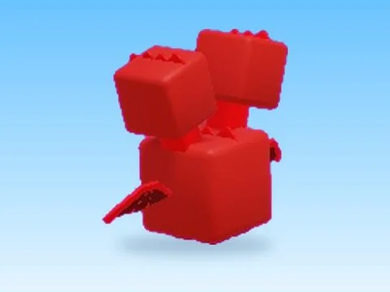

# Crimson Serpent · Hatching Simulator

Modèle en MeshParts « Crimson Serpent » (Hatching Simulator). Aperçu rendu dans Roblox Studio avec ses vraies textures.

- **Catégorie** : [Pets & meshes](../Pets%20%26%20meshes.md)
- **Sous-catégorie** : [Pets](Pets.md)
- **Type** : Modèle en MeshParts
- **Contenu** : 6 MeshParts
- **Jeu d'origine** : Hatching Simulator
- **Fichier source** : `models/ByType/Pets/HatchingSim_CrimsonSerpent.rbxm` (dans ta bibliothèque `rblx\lib`)
