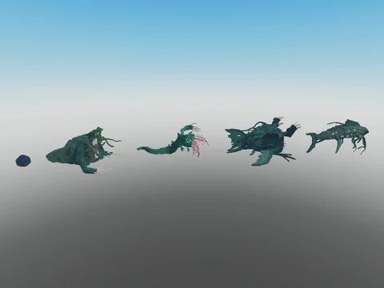

# Fish models (by Kronos)

Pack de poissons/brainrots aquatiques par Kronos classés par rareté (Common → Secret, Deep, Abyss, Cosmic, Nuclear, Event, Fishoween, Limited, Reward, Admin).

- **Catégorie** : [Pets & meshes](../Pets%20&%20meshes.md)
- **Sous-catégorie** : [Pets](Pets.md)
- **Type** : Pack de fichiers
- **Contenu** : 204 fichiers · 2,0 Mo
- **Fichier source** : `Assets/packs/Fish models by Kronos` (dans le vault)

## Fichiers (204)

- `fish models by Kronos.rbxm`
- `Abyss/Abyss Egg.rbxm`
- `Abyss/Deep Eater.rbxm`
- `Abyss/Drengothua.rbxm`
- `Abyss/Seeker.rbxm`
- `Abyss/Zholthagru.rbxm`
- `Admin/Rave Turtle.rbxm`
- `Admin/Rog.rbxm`
- `Admin/Spinning Fish.rbxm`
- `Admin/Taco Fish.rbxm`
- `Common/Jellyfish.rbxm`
- `Common/Pufferfish.rbxm`
- `Common/Pufferturtle.rbxm`
- `Common/Salmon.rbxm`
- `Common/Sapper.rbxm`
- `Common/Sea Horse.rbxm`
- `Common/Sea Star.rbxm`
- `Common/Seatung.rbxm`
- `Common/Tralalero.rbxm`
- `Common/Tung Sahur.rbxm`
- `Common/Turtle.rbxm`
- `Cosmic/Bloop.rbxm`
- `Cosmic/Bloopvoid.rbxm`
- `Cosmic/Cosmic Egg.rbxm`
- `Cosmic/El Gran Maja.rbxm`
- `Cosmic/El Skeleton Maja.rbxm`
- `Cosmic/Future Monster.rbxm`
- `Cosmic/Infected Whale.rbxm`
- `Cosmic/Monster Prawn.rbxm`
- `Cosmic/Octobloop.rbxm`
- `Cosmic/Octowhale.rbxm`
- `Cosmic/Parabloopaly.rbxm`
- `Cosmic/Paranormaly.rbxm`
- `Cosmic/Sea Eater.rbxm`
- `Cosmic/Skeleton Bloop.rbxm`
- `Cosmic/Skeleton Eater.rbxm`
- `Deep/Baron.rbxm`
- `Deep/Deep Egg.rbxm`
- `Deep/Deep Mutated Boss.rbxm`
- `Deep/Leviathan.rbxm`
- `Deep/Mouth Titan.rbxm`
- `Deep/Mutated El Gran Maja.rbxm`
- `Deep/Nightmare Eater.rbxm`
- `Deep/Nightmare Maja.rbxm`
- `Deep/SCP.rbxm`
- `Deep/Sacabambathian.rbxm`
- `Deep/Tralalero Baron.rbxm`
- `Deep/World Eater.rbxm`
- `Epic/Axolotl.rbxm`
- `Epic/Creepy Chef.rbxm`
- `Epic/Eye Fish.rbxm`
- `Epic/Gold Fish.rbxm`
- `Epic/Hammer Shark.rbxm`
- `Epic/Mermaid.rbxm`
- `Epic/Saw Shark.rbxm`
- `Epic/Shark.rbxm`
- `Epic/Skeleton Fish.rbxm`
- `Epic/Sturgeon.rbxm`
- `Epic/The Waken.rbxm`
- `Event/Abyss Reaver.rbxm`
- `Event/Astraylis.rbxm`
- `Event/Auradrakth.rbxm`
- `Event/Aurorawhale.rbxm`
- `Event/Blaze.rbxm`
- `Event/Blood Baron.rbxm`
- `Event/Bloodreef.rbxm`
- `Event/Bluevein.rbxm`
- `Event/Chaos Cthulhu.rbxm`
- `Event/Creeper.rbxm`
- `Event/Cthulhu.rbxm`
- `Event/Dracopyra.rbxm`
- `Event/Elderein.rbxm`
- `Event/Eye of the Rift.rbxm`
- `Event/Eye of the Underworld.rbxm`
- `Event/Fallen Baron.rbxm`
- `Event/Frostclaw.rbxm`
- `Event/Gargantuan.rbxm`
- `Event/Glacier Wyrm.rbxm`
- `Event/Glacivor.rbxm`
- `Event/Ice Trawler.rbxm`
- `Event/Infernal Claw.rbxm`
- `Event/Keeper of the Underworld.rbxm`
- `Event/Lavadile.rbxm`
- `Event/Lightning Eel.rbxm`
- `Event/Luminis Alien.rbxm`
- `Event/Magma Shark.rbxm`
- `Event/Magmadile.rbxm`
- `Event/Mantorn.rbxm`
- `Event/Mutated Whale.rbxm`
- `Event/Necroclaw.rbxm`
- `Event/Orrhalon.rbxm`
- `Event/Raindrop Fish.rbxm`
- `Event/Reavercraft.rbxm`
- `Event/Rift Stalker.rbxm`
- `Event/Sad Turtle.rbxm`
- `Event/Scaleback.rbxm`
- `Event/Sea Dweller.rbxm`
- `Event/Slicktail.rbxm`
- `Event/Spineblade.rbxm`
- `Event/Star Strider.rbxm`
- `Event/Sun Fish.rbxm`
- `Event/The Blood Moon.rbxm`
- `Event/Tholthanua.rbxm`
- `Event/Turtalis.rbxm`
- `Event/Undead Eater.rbxm`
- `Event/Veil Alein.rbxm`
- `Event/Vhulgaros.rbxm`
- `Event/Voidwhale.rbxm`
- `Event/Volcaris.rbxm`
- `Event/Volcrath.rbxm`
- `Event/Weeping Jellyfish.rbxm`
- `Fishoween/Depths Brewer.rbxm`
- `Fishoween/Fishoween Moon.rbxm`
- `Fishoween/Flamed Rog.rbxm`
- `Fishoween/Frankenfish.rbxm`
- `Fishoween/Ghost Fish.rbxm`
- `Fishoween/Ghoul Koi.rbxm`
- `Fishoween/Grim Fisher.rbxm`
- `Fishoween/Haunted Egg.rbxm`
- `Fishoween/Hooked Horror.rbxm`
- `Fishoween/Lantern Jellyfish.rbxm`
- `Fishoween/Pumpkin Claw.rbxm`
- `Fishoween/Skeleton Leviathan.rbxm`
- `Fishoween/The Maw.rbxm`
- `Legendary/Bananita Dolphinita.rbxm`
- `Legendary/Barracuda Eater.rbxm`
- `Legendary/Capuchina Fish.rbxm`
- `Legendary/Frulli Frulla.rbxm`
- `Legendary/Infected Barracuda.rbxm`
- `Legendary/Long Skeleton.rbxm`
- `Legendary/Manta Ray.rbxm`
- `Legendary/Megalodon.rbxm`
- `Legendary/Nuke Fish.rbxm`
- `Legendary/Whale.rbxm`
- `Legendary/Worm.rbxm`
- `Limited/Demogorgon Worm.rbxm`
- `Limited/Eldritch Turtle.rbxm`
- `Limited/Evil Bloop.rbxm`
- `Limited/Infected Sky.rbxm`
- `Limited/Lurker.rbxm`
- `Limited/Orcalero Eater.rbxm`
- `Limited/Pumpkin Angler.rbxm`
- `Limited/Udindun Eater.rbxm`
- `Model.rbxm`
- `Mythic/Alein.rbxm`
- `Mythic/Blue Dragon.rbxm`
- `Mythic/Blue Worm.rbxm`
- `Mythic/Chef Crabracadabra.rbxm`
- `Mythic/Creepy Fish.rbxm`
- `Mythic/Godzilla.rbxm`
- `Mythic/Kraken.rbxm`
- `Mythic/Loch Ness.rbxm`
- `Mythic/Monster.rbxm`
- `Mythic/Mythic Egg.rbxm`
- `Mythic/Nightmare Shark.rbxm`
- `Mythic/Robolodon.rbxm`
- `Mythic/Train Eater.rbxm`
- `Mythic/Zombie Worm.rbxm`
- `Nuclear/Nuclear Egg.rbxm`
- `Nuclear/Radiated Moon.rbxm`
- `Nuclear/Radiated SCP.rbxm`
- `Nuclear/Radiated Zholthagru.rbxm`
- `Part.rbxm`
- `Rare/Anglerfish.rbxm`
- `Rare/Barracuda.rbxm`
- `Rare/Blobfish.rbxm`
- `Rare/Brr Patapim.rbxm`
- `Rare/Clown Din Din.rbxm`
- `Rare/Octopus.rbxm`
- `Rare/Piranha.rbxm`
- `Rare/Tralelelo Junior.rbxm`
- `Rare/Trippy Troppy.rbxm`
- `Rare/Trulimero Trulichina.rbxm`
- `Rare/Udin Din Din.rbxm`
- `Reward/Bullgor.rbxm`
- `Reward/Spikeworm.rbxm`
- `Reward/Valradon.rbxm`
- `Secret/Baby Deep Eater.rbxm`
- `Secret/Baby Scott.rbxm`
- `Secret/Hungry Deer.rbxm`
- `Secret/Hungry Tung.rbxm`
- `Secret/Job Sahur.rbxm`
- `Secret/Lirili Fish.rbxm`
- `Secret/Lirili Prawn.rbxm`
- `Secret/Nightmare Blobfish.rbxm`
- `Secret/Orcalelo Orcala.rbxm`
- `Secret/Sacabambaspis.rbxm`
- `Secret/Scottfish.rbxm`
- `Secret/Secret Egg.rbxm`
- `Secret/Spiderfish.rbxm`
- `Secret/The Moon.rbxm`
- `Secret/🤫 Egg.rbxm`
- `Uncommon/Baddie Crab.rbxm`
- `Uncommon/Baddie Fish.rbxm`
- `Uncommon/Bananini.rbxm`
- `Uncommon/Blue Tang.rbxm`
- `Uncommon/Boneca Ambalabu.rbxm`
- `Uncommon/Bonehead.rbxm`
- `Uncommon/Chrimp.rbxm`
- `Uncommon/Clownfish.rbxm`
- `Uncommon/Crab.rbxm`
- `Uncommon/Eel.rbxm`
- `Uncommon/Swordfish.rbxm`
- `Uncommon/Swordshrimp.rbxm`
