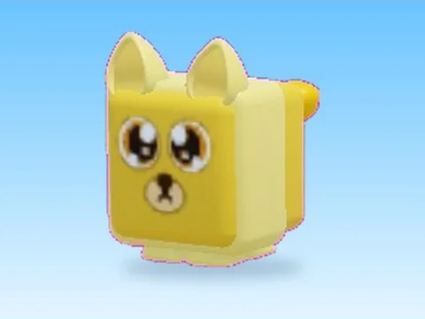

# Golden Huge Lion · Mining Masters

Modèle en MeshParts « Golden Huge Lion » (Mining Masters). Aperçu rendu dans Roblox Studio avec ses vraies textures.

- **Catégorie** : [Pets & meshes](../Pets%20%26%20meshes.md)
- **Sous-catégorie** : [Pets](Pets.md)
- **Type** : Modèle en MeshParts
- **Contenu** : 9 MeshParts
- **Jeu d'origine** : Mining Masters
- **Fichier source** : `models/ByType/Pets/MiningMasters_GoldenHugeLion.rbxm` (dans ta bibliothèque `rblx\lib`)
