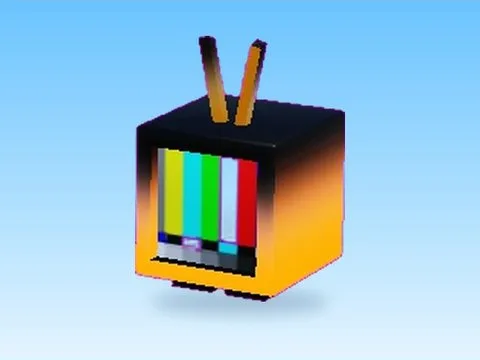

# Huge Magma TV · Pet Pharmica

Modèle en MeshParts « Huge Magma TV » (Pet Pharmica). Aperçu rendu dans Roblox Studio avec ses vraies textures.

- **Catégorie** : [Pets & meshes](../Pets%20%26%20meshes.md)
- **Sous-catégorie** : [Pets](Pets.md)
- **Type** : Modèle en MeshParts
- **Contenu** : 5 MeshParts
- **Jeu d'origine** : Pet Pharmica
- **Fichier source** : `models/ByType/Pets/PetPharmica_HugeMagmaTV.rbxm` (dans ta bibliothèque `rblx\lib`)
