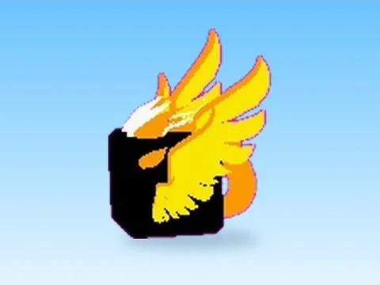

# Mythic Luminance · Glass Bridge

Modèle en MeshParts « Mythic Luminance » (Glass Bridge). Aperçu rendu dans Roblox Studio avec ses vraies textures.

- **Catégorie** : [Pets & meshes](../Pets%20&%20meshes.md)
- **Sous-catégorie** : [Pets](Pets.md)
- **Type** : Modèle en MeshParts
- **Contenu** : 5 MeshParts
- **Jeu d'origine** : Glass Bridge
- **Fichier source** : `Assets/models/ByType/Pets/GlassBridge_MythicLuminance.rbxm` (dans le vault)
