# Pets

Sous-catégorie de [Pets & meshes](../Pets%20&%20meshes.md) · **203 éléments**

| Aperçu | Élément | Infos |
| --- | --- | --- |
| 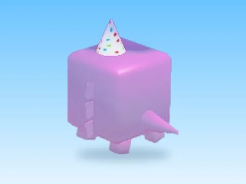 | [1k Axolotl · Pet Pharmica](1k%20Axolotl%20%C2%B7%20Pet%20Pharmica.md) | Modèle en MeshParts · 13 MeshParts |
| 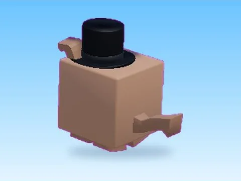 | [1k Dog · Pet Pharmica](1k%20Dog%20%C2%B7%20Pet%20Pharmica.md) | Modèle en MeshParts · 5 MeshParts |
|  | [1k Pearl · Pet Pharmica](1k%20Pearl%20%C2%B7%20Pet%20Pharmica.md) | Modèle en MeshParts · 2 MeshParts |
| 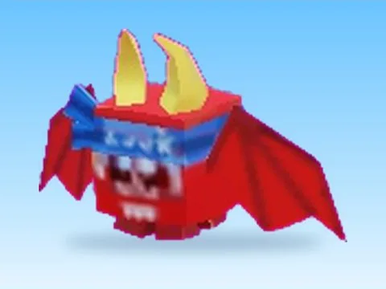 | [250k Dragon · Punch Simulator](250k%20Dragon%20%C2%B7%20Punch%20Simulator.md) | Modèle en MeshParts · 1 MeshPart |
| 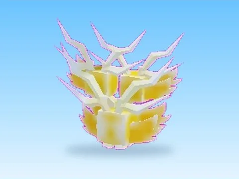 | [2MSerpent · Punch Simulator](2MSerpent%20%C2%B7%20Punch%20Simulator.md) | Modèle en MeshParts · 1 MeshPart |
| 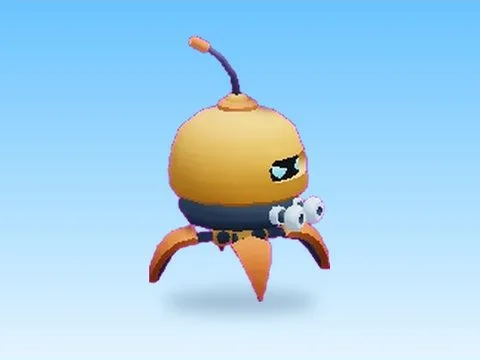 | [Alien Robot · Bakery Simulator](Alien%20Robot%20%C2%B7%20Bakery%20Simulator.md) | Modèle en MeshParts · 1 MeshPart |
| 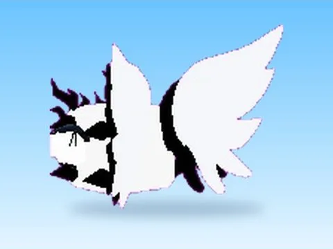 | [Arcc · Pet Pharmica](Arcc%20%C2%B7%20Pet%20Pharmica.md) | Modèle en MeshParts · 16 Parts · 15 MeshParts |
| 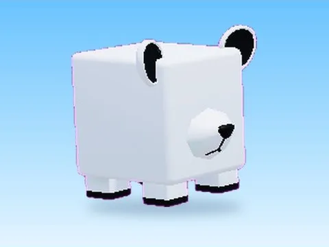 | [Arctic Bear · Cashgrab Bridge](Arctic%20Bear%20%C2%B7%20Cashgrab%20Bridge.md) | Modèle en MeshParts · 1 MeshPart |
|  | [Artic Cat · Mining Masters](Artic%20Cat%20%C2%B7%20Mining%20Masters.md) | Modèle en MeshParts · 10 MeshParts |
| 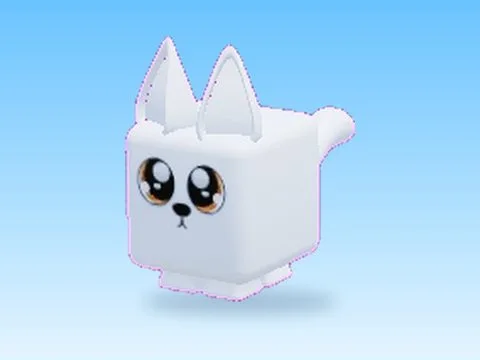 | [Artic Fox · Mining Masters](Artic%20Fox%20%C2%B7%20Mining%20Masters.md) | Modèle en MeshParts · 10 MeshParts |
| 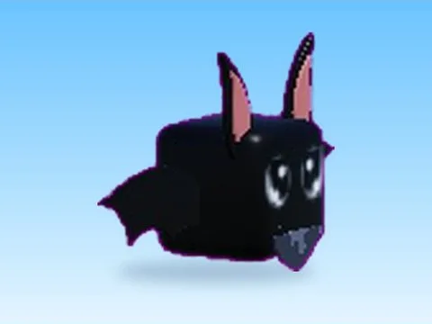 | [Bat · Cashgrab Bridge](Bat%20%C2%B7%20Cashgrab%20Bridge.md) | Modèle en MeshParts · 6 MeshParts |
| 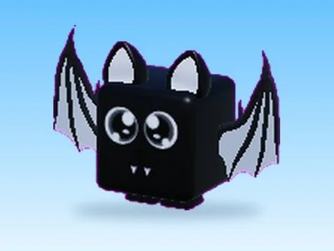 | [Bat · Mining Masters](Bat%20%C2%B7%20Mining%20Masters.md) | Modèle en MeshParts · 10 MeshParts |
| 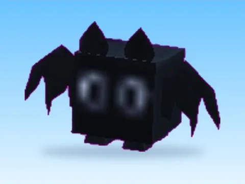 | [Bat · Punch Simulator](Bat%20%C2%B7%20Punch%20Simulator.md) | Modèle en MeshParts · 1 MeshPart |
| 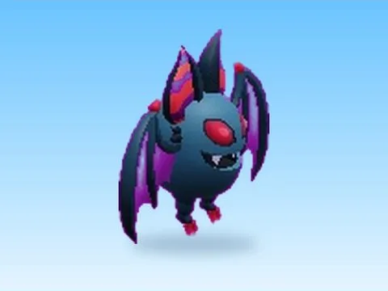 | [Batty · Bakery Simulator](Batty%20%C2%B7%20Bakery%20Simulator.md) | Modèle en MeshParts · 1 MeshPart |
| 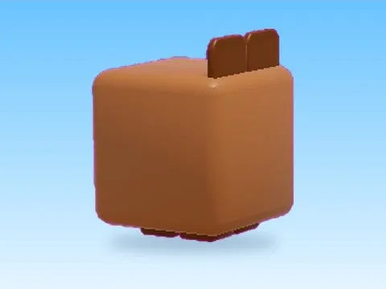 | [Bear · Hatching Simulator](Bear%20%C2%B7%20Hatching%20Simulator.md) | Modèle en MeshParts · 3 MeshParts |
| 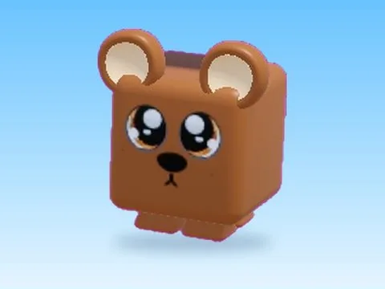 | [Bear · Mining Masters](Bear%20%C2%B7%20Mining%20Masters.md) | Modèle en MeshParts · 10 MeshParts |
| 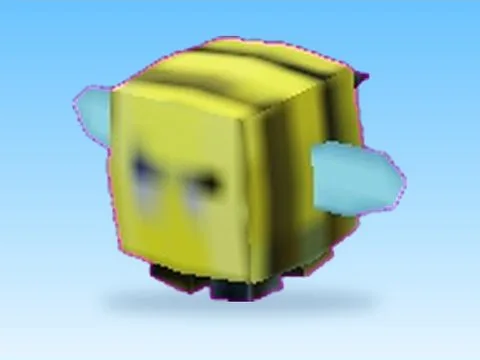 | [Bee · Punch Simulator](Bee%20%C2%B7%20Punch%20Simulator.md) | Modèle en MeshParts · 1 MeshPart |
| 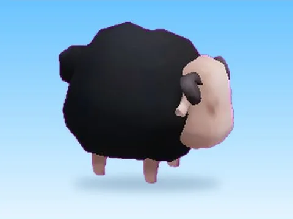 | [Black Sheep · Bakery Simulator](Black%20Sheep%20%C2%B7%20Bakery%20Simulator.md) | Modèle en MeshParts · 1 MeshPart |
|  | [Blue · Cashgrab Bridge](Blue%20%C2%B7%20Cashgrab%20Bridge.md) | Modèle en MeshParts · 4 MeshParts |
| 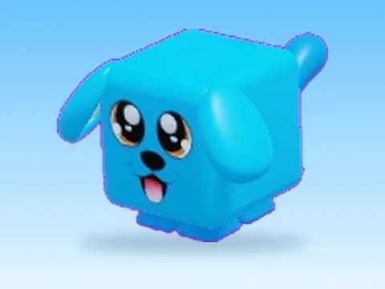 | [Blue Dog · Mining Masters](Blue%20Dog%20%C2%B7%20Mining%20Masters.md) | Modèle en MeshParts · 10 MeshParts |
| 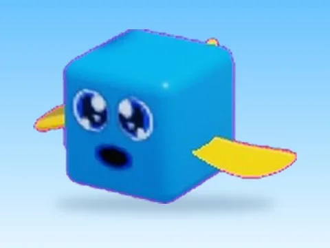 | [Blue Fish · Mining Masters](Blue%20Fish%20%C2%B7%20Mining%20Masters.md) | Modèle en MeshParts · 2 MeshParts |
| 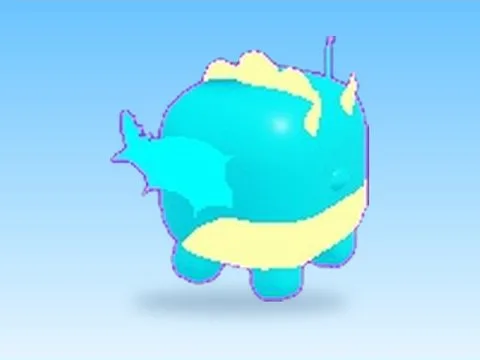 | [Blue Horned Dragon · Magnet Simulator 2](Blue%20Horned%20Dragon%20%C2%B7%20Magnet%20Simulator%202.md) | Modèle en MeshParts · 9 MeshParts |
|  | [Boar · Bakery Simulator](Boar%20%C2%B7%20Bakery%20Simulator.md) | Modèle en MeshParts · 1 MeshPart |
| 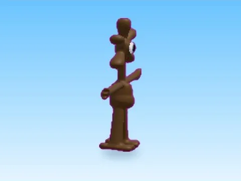 | [Brown · Cashgrab Bridge](Brown%20%C2%B7%20Cashgrab%20Bridge.md) | Modèle en MeshParts · 1 MeshPart |
| 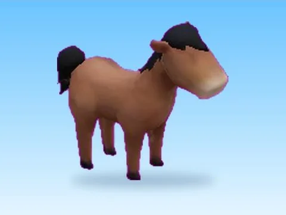 | [Brown Horse · Bakery Simulator](Brown%20Horse%20%C2%B7%20Bakery%20Simulator.md) | Modèle en MeshParts · 1 MeshPart |
| 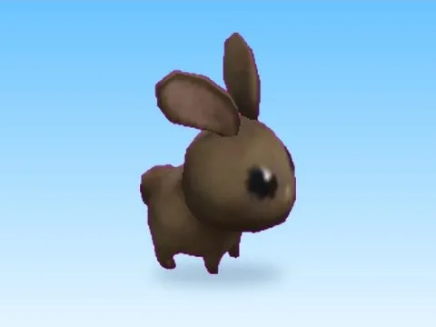 | [Brown Rabbit · Bakery Simulator](Brown%20Rabbit%20%C2%B7%20Bakery%20Simulator.md) | Modèle en MeshParts · 1 MeshPart |
| 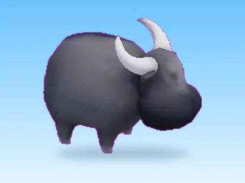 | [Bull · Bakery Simulator](Bull%20%C2%B7%20Bakery%20Simulator.md) | Modèle en MeshParts · 1 MeshPart |
| 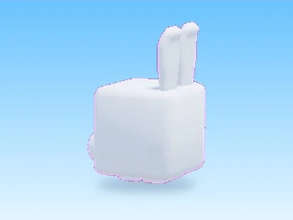 | [Bunny · Hatching Simulator](Bunny%20%C2%B7%20Hatching%20Simulator.md) | Modèle en MeshParts · 3 MeshParts |
|  | [Bunny · Mining Masters](Bunny%20%C2%B7%20Mining%20Masters.md) | Modèle en MeshParts · 8 MeshParts |
| 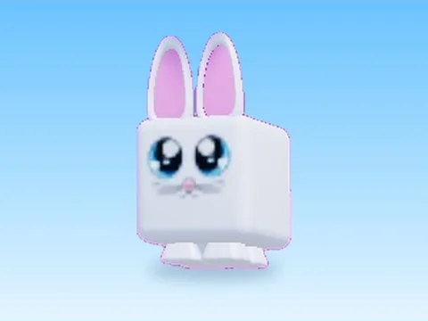 | [Bunny 2 · Mining Masters](Bunny%202%20%C2%B7%20Mining%20Masters.md) | Modèle en MeshParts · 10 MeshParts |
| 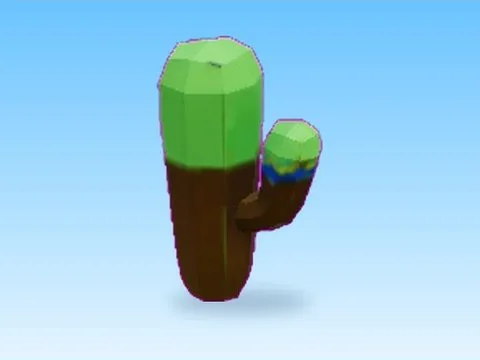 | [Cactus Boi · Punch Simulator](Cactus%20Boi%20%C2%B7%20Punch%20Simulator.md) | Modèle en MeshParts · 1 MeshPart |
| 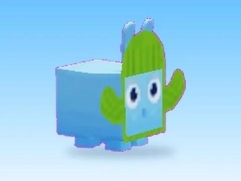 | [Cactus Bunny · +1 Jump Every Second](Cactus%20Bunny%20%C2%B7%20+1%20Jump%20Every%20Second.md) | Modèle en MeshParts · 1 MeshPart |
| 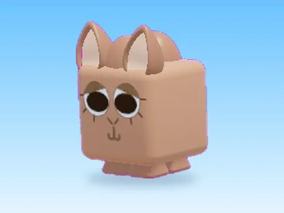 | [Camel · Mining Masters](Camel%20%C2%B7%20Mining%20Masters.md) | Modèle en MeshParts · 8 MeshParts |
| 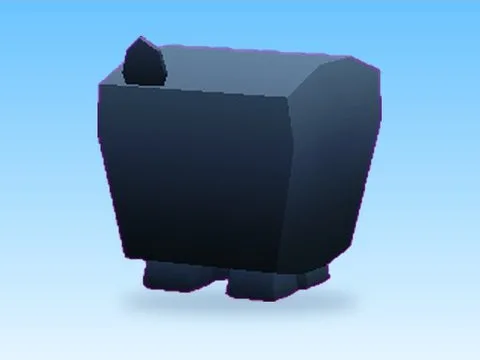 | [Cat · +1 Health Every Second](Cat%20%C2%B7%20+1%20Health%20Every%20Second.md) | Modèle en MeshParts · 1 MeshPart |
| 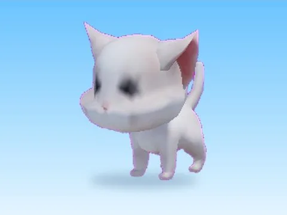 | [Cat · Bakery Simulator](Cat%20%C2%B7%20Bakery%20Simulator.md) | Modèle en MeshParts · 1 MeshPart |
| 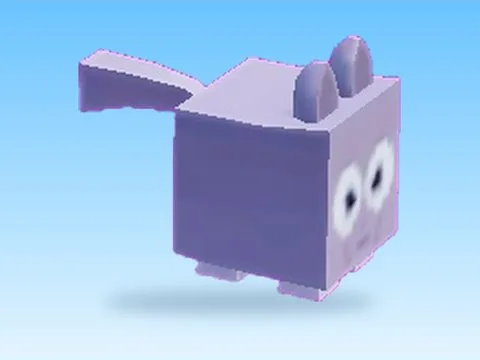 | [Cat · Punch Simulator](Cat%20%C2%B7%20Punch%20Simulator.md) | Modèle en MeshParts · 1 MeshPart |
| 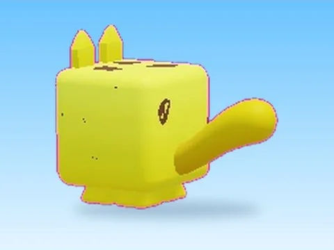 | [Cheetah · Mining Masters](Cheetah%20%C2%B7%20Mining%20Masters.md) | Modèle en MeshParts · 3 MeshParts |
| 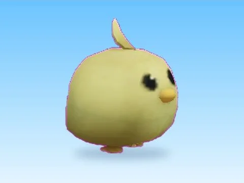 | [Chick · Bakery Simulator](Chick%20%C2%B7%20Bakery%20Simulator.md) | Modèle en MeshParts · 1 MeshPart |
| 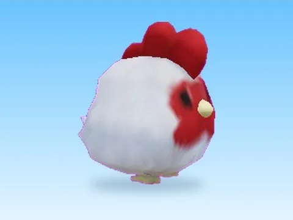 | [Chicken · Bakery Simulator](Chicken%20%C2%B7%20Bakery%20Simulator.md) | Modèle en MeshParts · 1 MeshPart |
| 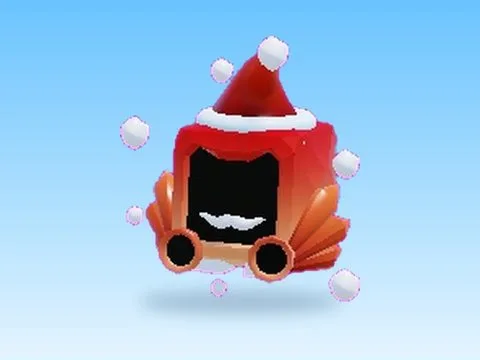 | [Christmas Dominus · +1 Health Every Second](Christmas%20Dominus%20%C2%B7%20+1%20Health%20Every%20Second.md) | Modèle en MeshParts · 1 MeshPart |
| 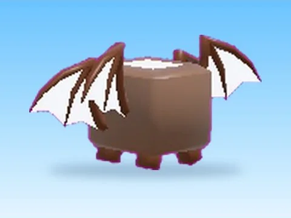 | [Coconut Lord · Pet Pharmica](Coconut%20Lord%20%C2%B7%20Pet%20Pharmica.md) | Modèle en MeshParts · 14 MeshParts |
|  | [Community Beast · Punch Simulator](Community%20Beast%20%C2%B7%20Punch%20Simulator.md) | Modèle en MeshParts · 2 MeshParts |
| 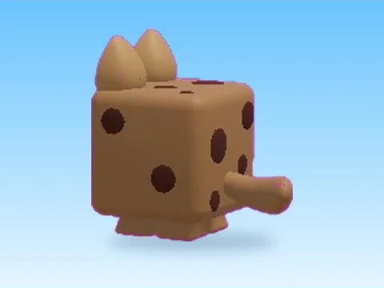 | [Cookie Cat · Mining Masters](Cookie%20Cat%20%C2%B7%20Mining%20Masters.md) | Modèle en MeshParts · 4 MeshParts |
| 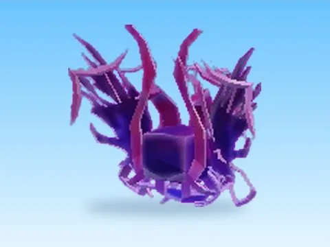 | [Cosmic Cyborg · Punch Simulator](Cosmic%20Cyborg%20%C2%B7%20Punch%20Simulator.md) | Modèle en MeshParts · 1 MeshPart |
| 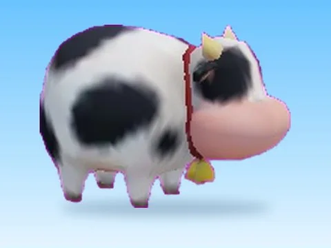 | [Cow · Bakery Simulator](Cow%20%C2%B7%20Bakery%20Simulator.md) | Modèle en MeshParts · 1 MeshPart |
| 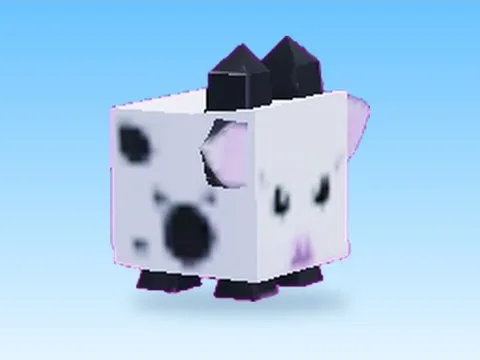 | [Cow · Punch Simulator](Cow%20%C2%B7%20Punch%20Simulator.md) | Modèle en MeshParts · 1 MeshPart |
| 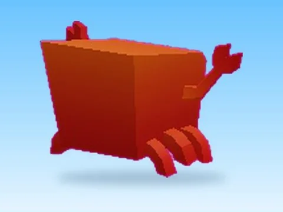 | [Crabby · +1 Health Every Second](Crabby%20%C2%B7%20+1%20Health%20Every%20Second.md) | Modèle en MeshParts · 1 MeshPart |
| 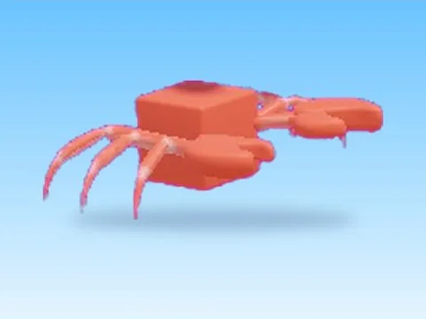 | [Crabby Crab · Cashgrab Bridge](Crabby%20Crab%20%C2%B7%20Cashgrab%20Bridge.md) | Modèle en MeshParts · 1 MeshPart |
| 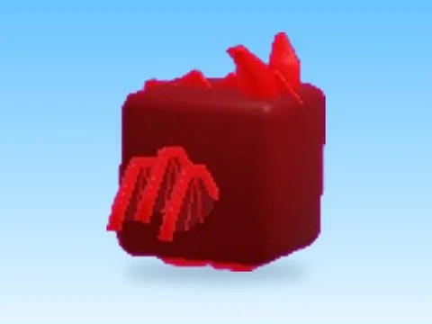 | [Crimson Overlord · Hatching Simulator](Crimson%20Overlord%20%C2%B7%20Hatching%20Simulator.md) | Modèle en MeshParts · 5 MeshParts |
|  | [Crimson Serpent · Hatching Simulator](Crimson%20Serpent%20%C2%B7%20Hatching%20Simulator.md) | Modèle en MeshParts · 6 MeshParts |
| 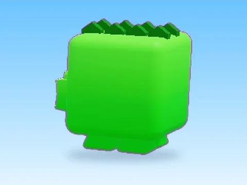 | [Crocodile · Mining Masters](Crocodile%20%C2%B7%20Mining%20Masters.md) | Modèle en MeshParts · 3 MeshParts |
| 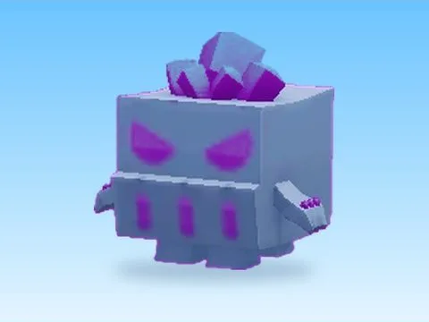 | [Crystal Golem · +1 Jump Every Second](Crystal%20Golem%20%C2%B7%20+1%20Jump%20Every%20Second.md) | Modèle en MeshParts · 1 MeshPart |
| 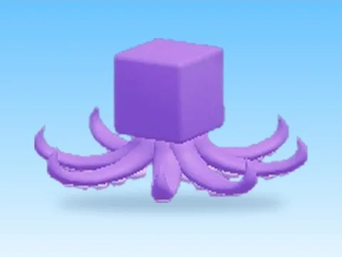 | [Cuddly Octopus · Cashgrab Bridge](Cuddly%20Octopus%20%C2%B7%20Cashgrab%20Bridge.md) | Modèle en MeshParts · 1 MeshPart |
| 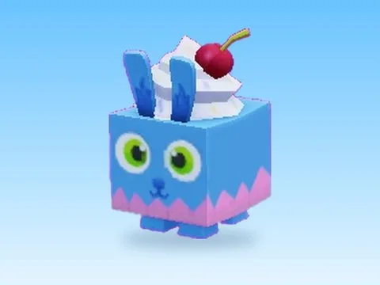 | [Cupcake Bunny · +1 Health Every Second](Cupcake%20Bunny%20%C2%B7%20+1%20Health%20Every%20Second.md) | Modèle en MeshParts · 1 MeshPart |
| 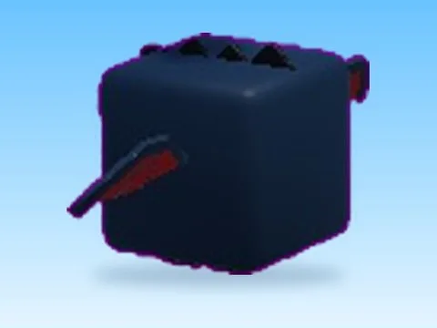 | [Dark Dragon · Hatching Simulator](Dark%20Dragon%20%C2%B7%20Hatching%20Simulator.md) | Modèle en MeshParts · 14 MeshParts |
| 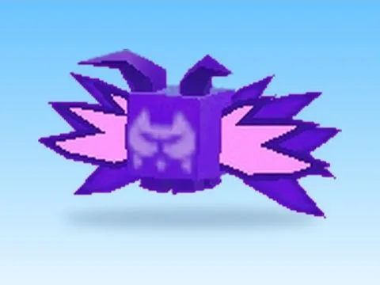 | [Dark Spirit · Punch Simulator](Dark%20Spirit%20%C2%B7%20Punch%20Simulator.md) | Modèle en MeshParts · 2 MeshParts |
| 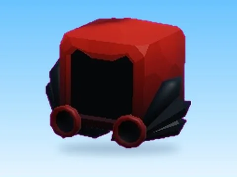 | [Deadly Dark Dominus · +1 Health Every Second](Deadly%20Dark%20Dominus%20%C2%B7%20+1%20Health%20Every%20Second.md) | Modèle en MeshParts · 1 MeshPart |
|  | [Desert Dragon · Punch Simulator](Desert%20Dragon%20%C2%B7%20Punch%20Simulator.md) | Modèle en MeshParts · 1 MeshPart |
|  | [Desert Fox · Punch Simulator](Desert%20Fox%20%C2%B7%20Punch%20Simulator.md) | Modèle en MeshParts · 1 MeshPart |
|  | [Developer Monkey · Punch Simulator](Developer%20Monkey%20%C2%B7%20Punch%20Simulator.md) | Modèle en MeshParts · 1 MeshPart |
|  | [Dizzy Flower · +1 Jump Every Second](Dizzy%20Flower%20%C2%B7%20+1%20Jump%20Every%20Second.md) | Modèle en MeshParts · 1 MeshPart |
|  | [Dog · Punch Simulator](Dog%20%C2%B7%20Punch%20Simulator.md) | Modèle en MeshParts · 1 MeshPart |
|  | [Doggy · Hatching Simulator](Doggy%20%C2%B7%20Hatching%20Simulator.md) | Modèle en MeshParts · 6 MeshParts |
|  | [Dominus Angelic · Pet Pharmica](Dominus%20Angelic%20%C2%B7%20Pet%20Pharmica.md) | Modèle en MeshParts · 5 MeshParts |
|  | [Donut · +1 Health Every Second](Donut%20%C2%B7%20+1%20Health%20Every%20Second.md) | Modèle en MeshParts · 1 MeshPart |
|  | [Dragon Plushie · Glass Bridge](Dragon%20Plushie%20%C2%B7%20Glass%20Bridge.md) | Modèle en MeshParts · 12 MeshParts |
|  | [Duck · Bakery Simulator](Duck%20%C2%B7%20Bakery%20Simulator.md) | Modèle en MeshParts · 1 MeshPart |
|  | [Electric Hydra · Hatching Simulator](Electric%20Hydra%20%C2%B7%20Hatching%20Simulator.md) | Modèle en MeshParts · 4 MeshParts |
|  | [Elephant · Cashgrab Bridge](Elephant%20%C2%B7%20Cashgrab%20Bridge.md) | Modèle en MeshParts · 5 MeshParts |
|  | [Elephant · Magnet Simulator 2](Elephant%20%C2%B7%20Magnet%20Simulator%202.md) | Modèle en MeshParts · 4 MeshParts |
|  | [Elephant · Punch Simulator](Elephant%20%C2%B7%20Punch%20Simulator.md) | Modèle en MeshParts · 1 MeshPart |
|  | [Emerald Golem · Hatching Simulator](Emerald%20Golem%20%C2%B7%20Hatching%20Simulator.md) | Modèle en MeshParts · 3 MeshParts |
|  | [Fallen Angel · Hatching Simulator](Fallen%20Angel%20%C2%B7%20Hatching%20Simulator.md) | Modèle en MeshParts · 5 MeshParts |
|  | [Fallen Dragon · Hatching Simulator](Fallen%20Dragon%20%C2%B7%20Hatching%20Simulator.md) | Modèle en MeshParts · 11 MeshParts |
|  | [Fallen Golem · Hatching Simulator](Fallen%20Golem%20%C2%B7%20Hatching%20Simulator.md) | Modèle en MeshParts · 3 MeshParts |
|  | [Fallen Owl · Hatching Simulator](Fallen%20Owl%20%C2%B7%20Hatching%20Simulator.md) | Modèle en MeshParts · 5 MeshParts |
|  | [Fallen Spike · Hatching Simulator](Fallen%20Spike%20%C2%B7%20Hatching%20Simulator.md) | Modèle en MeshParts · 3 MeshParts |
|  | [Fallen Stack · Hatching Simulator](Fallen%20Stack%20%C2%B7%20Hatching%20Simulator.md) | Modèle en MeshParts · 2 MeshParts |
|  | [Fire Pegasus · Mining Masters](Fire%20Pegasus%20%C2%B7%20Mining%20Masters.md) | Modèle en MeshParts · 12 MeshParts |
|  | [Fire Slime · Mining Masters](Fire%20Slime%20%C2%B7%20Mining%20Masters.md) | Modèle en MeshParts · 1 MeshPart |
|  | [Fish · Mining Masters](Fish%20%C2%B7%20Mining%20Masters.md) | Modèle en MeshParts · 4 MeshParts |
|  | [Flame Bear · Hatching Simulator](Flame%20Bear%20%C2%B7%20Hatching%20Simulator.md) | Modèle en MeshParts · 3 MeshParts |
|  | [Flame Cube · Hatching Simulator](Flame%20Cube%20%C2%B7%20Hatching%20Simulator.md) | Modèle en MeshParts · 5 MeshParts |
|  | [Flame Doggy · Hatching Simulator](Flame%20Doggy%20%C2%B7%20Hatching%20Simulator.md) | Modèle en MeshParts · 6 MeshParts |
|  | [Flame Kitty · Hatching Simulator](Flame%20Kitty%20%C2%B7%20Hatching%20Simulator.md) | Modèle en MeshParts · 3 MeshParts |
|  | [Flame Marshmallow · Hatching Simulator](Flame%20Marshmallow%20%C2%B7%20Hatching%20Simulator.md) | Modèle en MeshParts · 4 MeshParts |
|  | [Fox · Magnet Simulator 2](Fox%20%C2%B7%20Magnet%20Simulator%202.md) | Modèle en MeshParts · 5 Parts · 16 MeshParts |
|  | [Frost Boi · Hatching Simulator](Frost%20Boi%20%C2%B7%20Hatching%20Simulator.md) | Modèle en MeshParts · 2 MeshParts |
|  | [Frost Dragon · +1 Jump Every Second](Frost%20Dragon%20%C2%B7%20+1%20Jump%20Every%20Second.md) | Modèle en MeshParts · 1 MeshPart |
|  | [Frost Hearth · Pet Pharmica](Frost%20Hearth%20%C2%B7%20Pet%20Pharmica.md) | Modèle en MeshParts · 4 MeshParts |
|  | [Frost Kitty · Hatching Simulator](Frost%20Kitty%20%C2%B7%20Hatching%20Simulator.md) | Modèle en MeshParts · 3 MeshParts |
|  | [Frost Unicorn · Hatching Simulator](Frost%20Unicorn%20%C2%B7%20Hatching%20Simulator.md) | Modèle en MeshParts · 3 MeshParts |
|  | [Galactic Alien · Punch Simulator](Galactic%20Alien%20%C2%B7%20Punch%20Simulator.md) | Modèle en MeshParts · 1 MeshPart |
|  | [Galactic Elemental · Hatching Simulator](Galactic%20Elemental%20%C2%B7%20Hatching%20Simulator.md) | Modèle en MeshParts · 2 MeshParts |
|  | [Galaxy Cat · Punch Simulator](Galaxy%20Cat%20%C2%B7%20Punch%20Simulator.md) | Modèle en MeshParts · 1 MeshPart |
|  | [Galaxy Dragon · Punch Simulator](Galaxy%20Dragon%20%C2%B7%20Punch%20Simulator.md) | Modèle en MeshParts · 1 MeshPart |
|  | [Gift · Punch Simulator](Gift%20%C2%B7%20Punch%20Simulator.md) | Modèle en MeshParts · 1 MeshPart |
|  | [Gingerbread Dog · Mining Masters](Gingerbread%20Dog%20%C2%B7%20Mining%20Masters.md) | Modèle en MeshParts · 10 MeshParts |
|  | [Glowy Skull · +1 Jump Every Second](Glowy%20Skull%20%C2%B7%20+1%20Jump%20Every%20Second.md) | Modèle en MeshParts · 1 MeshPart |
|  | [Gnome Bear · +1 Jump Every Second](Gnome%20Bear%20%C2%B7%20+1%20Jump%20Every%20Second.md) | Modèle en MeshParts · 1 MeshPart |
|  | [Goat · Bakery Simulator](Goat%20%C2%B7%20Bakery%20Simulator.md) | Modèle en MeshParts · 1 MeshPart |
|  | [Golden Green Gecko · Mining Masters](Golden%20Green%20Gecko%20%C2%B7%20Mining%20Masters.md) | Modèle en MeshParts · 4 MeshParts |
|  | [Golden Griffin · Mining Masters](Golden%20Griffin%20%C2%B7%20Mining%20Masters.md) | Modèle en MeshParts · 9 MeshParts |
|  | [Golden Huge Crab · Mining Masters](Golden%20Huge%20Crab%20%C2%B7%20Mining%20Masters.md) | Modèle en MeshParts · 5 MeshParts |
|  | [Golden Huge Donut · Mining Masters](Golden%20Huge%20Donut%20%C2%B7%20Mining%20Masters.md) | Modèle en MeshParts · 2 MeshParts |
|  | [Golden Huge Killer Dog · Mining Masters](Golden%20Huge%20Killer%20Dog%20%C2%B7%20Mining%20Masters.md) | Modèle en MeshParts · 1 MeshPart |
|  | [Golden Huge Lion · Mining Masters](Golden%20Huge%20Lion%20%C2%B7%20Mining%20Masters.md) | Modèle en MeshParts · 9 MeshParts |
|  | [Golden Huge Mega Robot · Mining Masters](Golden%20Huge%20Mega%20Robot%20%C2%B7%20Mining%20Masters.md) | Modèle en MeshParts · 15 MeshParts |
|  | [Golden Huge Monkey · Mining Masters](Golden%20Huge%20Monkey%20%C2%B7%20Mining%20Masters.md) | Modèle en MeshParts · 3 MeshParts |
|  | [Golden Huge Reindeer · Mining Masters](Golden%20Huge%20Reindeer%20%C2%B7%20Mining%20Masters.md) | Modèle en MeshParts · 5 MeshParts |
|  | [Golden Lollipop · Mining Masters](Golden%20Lollipop%20%C2%B7%20Mining%20Masters.md) | Modèle en MeshParts · 2 MeshParts |
|  | [Golden Marsh Mallow · Mining Masters](Golden%20Marsh%20Mallow%20%C2%B7%20Mining%20Masters.md) | Modèle en MeshParts · 1 MeshPart |
|  | [Golden Octopus · Mining Masters](Golden%20Octopus%20%C2%B7%20Mining%20Masters.md) | Modèle en MeshParts · 1 MeshPart |
|  | [Golden Penguin · Mining Masters](Golden%20Penguin%20%C2%B7%20Mining%20Masters.md) | Modèle en MeshParts · 4 MeshParts |
|  | [Golden Purple Gecko · Mining Masters](Golden%20Purple%20Gecko%20%C2%B7%20Mining%20Masters.md) | Modèle en MeshParts · 4 MeshParts |
|  | [Golden Seahorse · Mining Masters](Golden%20Seahorse%20%C2%B7%20Mining%20Masters.md) | Modèle en MeshParts · 2 MeshParts |
|  | [Golden Shark · Mining Masters](Golden%20Shark%20%C2%B7%20Mining%20Masters.md) | Modèle en MeshParts · 2 MeshParts |
|  | [Golden Snake · Mining Masters](Golden%20Snake%20%C2%B7%20Mining%20Masters.md) | Modèle en MeshParts · 3 MeshParts |
|  | [Golden Snow Man · Mining Masters](Golden%20Snow%20Man%20%C2%B7%20Mining%20Masters.md) | Modèle en MeshParts · 7 MeshParts |
|  | [Golden Star Fish · Mining Masters](Golden%20Star%20Fish%20%C2%B7%20Mining%20Masters.md) | Modèle en MeshParts · 7 MeshParts |
|  | [Golem · Hatching Simulator](Golem%20%C2%B7%20Hatching%20Simulator.md) | Modèle en MeshParts · 3 MeshParts |
|  | [Gorilla · Mining Masters](Gorilla%20%C2%B7%20Mining%20Masters.md) | Modèle en MeshParts · 1 MeshPart |
|  | [Grass · Punch Simulator](Grass%20%C2%B7%20Punch%20Simulator.md) | Modèle en MeshParts · 1 MeshPart |
|  | [Green Dragon · Magnet Simulator 2](Green%20Dragon%20%C2%B7%20Magnet%20Simulator%202.md) | Modèle en MeshParts · 6 MeshParts |
|  | [Hard Hat Parrot · Magnet Simulator 2](Hard%20Hat%20Parrot%20%C2%B7%20Magnet%20Simulator%202.md) | Modèle en MeshParts · 8 MeshParts |
|  | [Hell Wisp · Punch Simulator](Hell%20Wisp%20%C2%B7%20Punch%20Simulator.md) | Modèle en MeshParts · 2 MeshParts |
|  | [Holy Dominus · Punch Simulator](Holy%20Dominus%20%C2%B7%20Punch%20Simulator.md) | Modèle en MeshParts · 1 MeshPart |
|  | [Huge Cat · Pet Pharmica](Huge%20Cat%20%C2%B7%20Pet%20Pharmica.md) | Modèle en MeshParts · 1 MeshPart |
|  | [Huge Cthulhu · Punch Simulator](Huge%20Cthulhu%20%C2%B7%20Punch%20Simulator.md) | Modèle en MeshParts · 1 MeshPart |
|  | [Huge Magma TV · Pet Pharmica](Huge%20Magma%20TV%20%C2%B7%20Pet%20Pharmica.md) | Modèle en MeshParts · 5 MeshParts |
|  | [Huge Robux Doggy · Mining Masters](Huge%20Robux%20Doggy%20%C2%B7%20Mining%20Masters.md) | Modèle en MeshParts · 2 MeshParts |
|  | [Husky · +1 Jump Every Second](Husky%20%C2%B7%20+1%20Jump%20Every%20Second.md) | Modèle en MeshParts · 1 MeshPart |
|  | [Ice Cream Gnome · +1 Health Every Second](Ice%20Cream%20Gnome%20%C2%B7%20+1%20Health%20Every%20Second.md) | Modèle en MeshParts · 1 MeshPart |
|  | [Ice Fiend · Magnet Simulator 2](Ice%20Fiend%20%C2%B7%20Magnet%20Simulator%202.md) | Modèle en MeshParts · 20 MeshParts |
|  | [Ice Scorpion · Punch Simulator](Ice%20Scorpion%20%C2%B7%20Punch%20Simulator.md) | Modèle en MeshParts · 1 MeshPart |
|  | [Imperial Penguin · +1 Jump Every Second](Imperial%20Penguin%20%C2%B7%20+1%20Jump%20Every%20Second.md) | Modèle en MeshParts · 1 MeshPart |
|  | [Jaguar · Pet Pharmica](Jaguar%20%C2%B7%20Pet%20Pharmica.md) | Modèle en MeshParts · 5 MeshParts |
|  | [Jelly Bean Bear · +1 Health Every Second](Jelly%20Bean%20Bear%20%C2%B7%20+1%20Health%20Every%20Second.md) | Modèle en MeshParts · 1 MeshPart |
|  | [Jungle Bunny · Punch Simulator](Jungle%20Bunny%20%C2%B7%20Punch%20Simulator.md) | Modèle en MeshParts · 1 MeshPart |
|  | [Kitty · Cashgrab Bridge](Kitty%20%C2%B7%20Cashgrab%20Bridge.md) | Modèle en MeshParts · 4 MeshParts |
|  | [Kraken · Pet Pharmica](Kraken%20%C2%B7%20Pet%20Pharmica.md) | Modèle en MeshParts · 3 MeshParts |
|  | [Lava Angel · Punch Simulator](Lava%20Angel%20%C2%B7%20Punch%20Simulator.md) | Modèle en MeshParts · 1 MeshPart |
|  | [Lion · Cashgrab Bridge](Lion%20%C2%B7%20Cashgrab%20Bridge.md) | Modèle en MeshParts · 7 MeshParts |
|  | [Lion · Punch Simulator](Lion%20%C2%B7%20Punch%20Simulator.md) | Modèle en MeshParts · 1 MeshPart |
|  | [Magma Beast · Punch Simulator](Magma%20Beast%20%C2%B7%20Punch%20Simulator.md) | Modèle en MeshParts · 2 MeshParts |
|  | [Magma Crystalite · Punch Simulator](Magma%20Crystalite%20%C2%B7%20Punch%20Simulator.md) | Modèle en MeshParts · 1 MeshPart |
|  | [Magma Cube · Punch Simulator](Magma%20Cube%20%C2%B7%20Punch%20Simulator.md) | Modèle en MeshParts · 1 MeshPart |
|  | [Magma Demon · Punch Simulator](Magma%20Demon%20%C2%B7%20Punch%20Simulator.md) | Modèle en MeshParts · 1 MeshPart |
|  | [Magma Dragon · Pet Pharmica](Magma%20Dragon%20%C2%B7%20Pet%20Pharmica.md) | Modèle en MeshParts · 7 MeshParts |
|  | [Magma Hellfire · Punch Simulator](Magma%20Hellfire%20%C2%B7%20Punch%20Simulator.md) | Modèle en MeshParts · 1 MeshPart |
|  | [Magma Immortal · Pet Pharmica](Magma%20Immortal%20%C2%B7%20Pet%20Pharmica.md) | Modèle en MeshParts · 9 MeshParts |
|  | [Magma Rock · Pet Pharmica](Magma%20Rock%20%C2%B7%20Pet%20Pharmica.md) | Modèle en MeshParts · 2 MeshParts |
|  | [Marshmallow · +1 Jump Every Second](Marshmallow%20%C2%B7%20+1%20Jump%20Every%20Second.md) | Modèle en MeshParts · 1 MeshPart |
|  | [Miner Dog · +1 Jump Every Second](Miner%20Dog%20%C2%B7%20+1%20Jump%20Every%20Second.md) | Modèle en MeshParts · 1 MeshPart |
|  | [Monkey · Bakery Simulator](Monkey%20%C2%B7%20Bakery%20Simulator.md) | Modèle en MeshParts · 1 MeshPart |
|  | [Mushroom · +1 Jump Every Second](Mushroom%20%C2%B7%20+1%20Jump%20Every%20Second.md) | Modèle en MeshParts · 1 MeshPart |
|  | [Mythic Koi · Glass Bridge](Mythic%20Koi%20%C2%B7%20Glass%20Bridge.md) | Modèle en MeshParts · 8 MeshParts |
|  | [Mythic Luminance · Glass Bridge](Mythic%20Luminance%20%C2%B7%20Glass%20Bridge.md) | Modèle en MeshParts · 5 MeshParts |
|  | [Narwhal · +1 Jump Every Second](Narwhal%20%C2%B7%20+1%20Jump%20Every%20Second.md) | Modèle en MeshParts · 1 MeshPart |
|  | [Ocean Gem · Pet Pharmica](Ocean%20Gem%20%C2%B7%20Pet%20Pharmica.md) | Modèle en MeshParts · 2 MeshParts |
|  | [Ocean Lord · Pet Pharmica](Ocean%20Lord%20%C2%B7%20Pet%20Pharmica.md) | Modèle en MeshParts · 7 MeshParts |
|  | [Orange · Cashgrab Bridge](Orange%20%C2%B7%20Cashgrab%20Bridge.md) | Modèle en MeshParts · 1 MeshPart |
|  | [Orange Cat · Magnet Simulator 2](Orange%20Cat%20%C2%B7%20Magnet%20Simulator%202.md) | Modèle en MeshParts · 5 MeshParts |
|  | [Owl · Bakery Simulator](Owl%20%C2%B7%20Bakery%20Simulator.md) | Modèle en MeshParts · 1 MeshPart |
|  | [Owl · Cashgrab Bridge](Owl%20%C2%B7%20Cashgrab%20Bridge.md) | Modèle en MeshParts · 13 MeshParts |
|  | [Panda · Cashgrab Bridge](Panda%20%C2%B7%20Cashgrab%20Bridge.md) | Modèle en MeshParts · 5 MeshParts |
|  | [Panda · Hatching Simulator](Panda%20%C2%B7%20Hatching%20Simulator.md) | Modèle en MeshParts · 3 MeshParts |
|  | [Panther · Bakery Simulator](Panther%20%C2%B7%20Bakery%20Simulator.md) | Modèle en MeshParts · 1 MeshPart |
|  | [Parrot · Mining Masters](Parrot%20%C2%B7%20Mining%20Masters.md) | Modèle en MeshParts · 2 MeshParts |
|  | [Parrot · Pet Pharmica](Parrot%20%C2%B7%20Pet%20Pharmica.md) | Modèle en MeshParts · 10 MeshParts |
|  | [Pastel Shock · Hatching Simulator](Pastel%20Shock%20%C2%B7%20Hatching%20Simulator.md) | Modèle en MeshParts · 6 MeshParts |
|  | [Peacock · Cashgrab Bridge](Peacock%20%C2%B7%20Cashgrab%20Bridge.md) | Modèle en MeshParts · 8 MeshParts |
|  | [Penguin · Cashgrab Bridge](Penguin%20%C2%B7%20Cashgrab%20Bridge.md) | Modèle en MeshParts · 1 MeshPart |
|  | [Pig · Bakery Simulator](Pig%20%C2%B7%20Bakery%20Simulator.md) | Modèle en MeshParts · 1 MeshPart |
|  | [Pink · Cashgrab Bridge](Pink%20%C2%B7%20Cashgrab%20Bridge.md) | Modèle en MeshParts · 1 MeshPart |
|  | [Pinnata · +1 Jump Every Second](Pinnata%20%C2%B7%20+1%20Jump%20Every%20Second.md) | Modèle en MeshParts · 1 MeshPart |
|  | [Prisom · Pet Pharmica](Prisom%20%C2%B7%20Pet%20Pharmica.md) | Modèle en MeshParts · 24 MeshParts |
|  | [Pumpkin · +1 Health Every Second](Pumpkin%20%C2%B7%20+1%20Health%20Every%20Second.md) | Modèle en MeshParts · 1 MeshPart |
|  | [Pup · Bakery Simulator](Pup%20%C2%B7%20Bakery%20Simulator.md) | Modèle en MeshParts · 1 MeshPart |
|  | [Purple Fish · Mining Masters](Purple%20Fish%20%C2%B7%20Mining%20Masters.md) | Modèle en MeshParts · 2 MeshParts |
|  | [Red Fish · Mining Masters](Red%20Fish%20%C2%B7%20Mining%20Masters.md) | Modèle en MeshParts · 2 MeshParts |
|  | [Reindeer · Cashgrab Bridge](Reindeer%20%C2%B7%20Cashgrab%20Bridge.md) | Modèle en MeshParts · 1 MeshPart |
|  | [Release Boi · Hatching Simulator](Release%20Boi%20%C2%B7%20Hatching%20Simulator.md) | Modèle en MeshParts · 2 MeshParts |
|  | [Release Cone · Hatching Simulator](Release%20Cone%20%C2%B7%20Hatching%20Simulator.md) | Modèle en MeshParts · 3 MeshParts |
|  | [Release Dino · Hatching Simulator](Release%20Dino%20%C2%B7%20Hatching%20Simulator.md) | Modèle en MeshParts · 3 MeshParts |
|  | [Release Sphere · Hatching Simulator](Release%20Sphere%20%C2%B7%20Hatching%20Simulator.md) | Modèle en MeshParts · 3 MeshParts |
|  | [Robux Kitty · Mining Masters](Robux%20Kitty%20%C2%B7%20Mining%20Masters.md) | Modèle en MeshParts · 3 MeshParts |
|  | [Sea Turtle · Cashgrab Bridge](Sea%20Turtle%20%C2%B7%20Cashgrab%20Bridge.md) | Modèle en MeshParts · 1 MeshPart |
|  | [Sheep · Cashgrab Bridge](Sheep%20%C2%B7%20Cashgrab%20Bridge.md) | Modèle en MeshParts · 3 MeshParts |
|  | [Sheriff Bunny · +1 Jump Every Second](Sheriff%20Bunny%20%C2%B7%20+1%20Jump%20Every%20Second.md) | Modèle en MeshParts · 1 MeshPart |
|  | [Sloth · Cashgrab Bridge](Sloth%20%C2%B7%20Cashgrab%20Bridge.md) | Modèle en MeshParts · 3 MeshParts |
|  | [Snake · +1 Health Every Second](Snake%20%C2%B7%20+1%20Health%20Every%20Second.md) | Modèle en MeshParts · 1 MeshPart |
|  | [Snow King · Pet Pharmica](Snow%20King%20%C2%B7%20Pet%20Pharmica.md) | Modèle en MeshParts · 14 MeshParts |
|  | [Sombrero Cat · +1 Jump Every Second](Sombrero%20Cat%20%C2%B7%20+1%20Jump%20Every%20Second.md) | Modèle en MeshParts · 1 MeshPart |
|  | [Spidy · +1 Health Every Second](Spidy%20%C2%B7%20+1%20Health%20Every%20Second.md) | Modèle en MeshParts · 2 MeshParts |
|  | [Trophy · Hatching Simulator](Trophy%20%C2%B7%20Hatching%20Simulator.md) | Modèle en MeshParts · 30 MeshParts |
|  | [Turtle · Bakery Simulator](Turtle%20%C2%B7%20Bakery%20Simulator.md) | Modèle en MeshParts · 1 MeshPart |
|  | [Turtle · Mining Masters](Turtle%20%C2%B7%20Mining%20Masters.md) | Modèle en MeshParts · 2 MeshParts |
|  | [Unicorn · Cashgrab Bridge](Unicorn%20%C2%B7%20Cashgrab%20Bridge.md) | Modèle en MeshParts · 6 MeshParts |
|  | [Void Phoniex · Hatching Simulator](Void%20Phoniex%20%C2%B7%20Hatching%20Simulator.md) | Modèle en MeshParts · 3 MeshParts |
|  | [Walrus · +1 Jump Every Second](Walrus%20%C2%B7%20+1%20Jump%20Every%20Second.md) | Modèle en MeshParts · 1 MeshPart |
|  | [Walrus · Cashgrab Bridge](Walrus%20%C2%B7%20Cashgrab%20Bridge.md) | Modèle en MeshParts · 1 MeshPart |
|  | [Yellow · Cashgrab Bridge](Yellow%20%C2%B7%20Cashgrab%20Bridge.md) | Modèle en MeshParts · 4 MeshParts |
