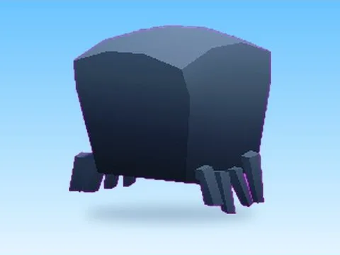

# Spidy · +1 Health Every Second

Modèle en MeshParts « Spidy » (+1 Health Every Second). Aperçu rendu dans Roblox Studio avec ses vraies textures.

- **Catégorie** : [Pets & meshes](../Pets%20&%20meshes.md)
- **Sous-catégorie** : [Pets](Pets.md)
- **Type** : Modèle en MeshParts
- **Contenu** : 2 MeshParts
- **Jeu d'origine** : +1 Health Every Second
- **Fichier source** : `Assets/models/ByType/Pets/1HealthEverySecond_Spidy.rbxm` (dans le vault)
