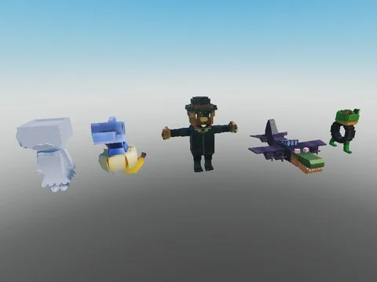

# Brainrots Steal an Spooky Egg — Normal (30)

Les 30 brainrots utilisés dans Steal an Spooky Egg, variante Normal.

- **Catégorie** : [Pets & meshes](../Pets%20&%20meshes.md)
- **Sous-catégorie** : [Steal an Spooky Egg](Steal%20an%20Spooky%20Egg%20%28Pets%20&%20meshes%29.md)
- **Type** : Pack de fichiers
- **Contenu** : 30 fichiers · 0,3 Mo
- **Jeu d'origine** : Steal an Spooky Egg
- **Fichier source** : `Assets/packs/Brainrots_SpookyGame/Normal` (dans le vault)

## Fichiers (30)

- `Ballerina Cappuccina.rbxm`
- `Bananita Dolphinita.rbxm`
- `Bobrito Bandito.rbxm`
- `Bombardiro Crocodilo.rbxm`
- `Boneca Ambalabu.rbxm`
- `Brr Brr Patapim.rbxm`
- `Burbaloni Luliloli.rbxm`
- `Cacto Hipopotamo.rbxm`
- `Cappuccino Assassino.rbxm`
- `Chicleteira Bicicleteira.rbxm`
- `Chimpanzini Bananini.rbxm`
- `Dragon Cannelloni.rbxm`
- `Fluri Flura.rbxm`
- `Gangster Footera.rbxm`
- `La Grande Combinasion.rbxm`
- `La Vacca Saturno Saturnita.rbxm`
- `Lirili Larila.rbxm`
- `Odin Din Din Dun.rbxm`
- `Orcalero Orcala.rbxm`
- `Pipi Kiwi.rbxm`
- `Pipi Potato.rbxm`
- `Strawberry Elephant.rbxm`
- `Svinina Bombardino.rbxm`
- `Ta Ta Ta Ta Sahur.rbxm`
- `Talpa Di Fero.rbxm`
- `Tim Cheese.rbxm`
- `Tralalero Tralala.rbxm`
- `Trippi Troppi.rbxm`
- `Trulimero Trulicina.rbxm`
- `Tung Sahur.rbxm`
