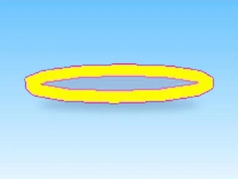

# Carry

Modèle en MeshParts « Carry ». Aperçu rendu dans Roblox Studio avec ses vraies textures.

- **Catégorie** : [Pets & meshes](../Pets%20%26%20meshes.md)
- **Sous-catégorie** : [Steal an Spooky Egg](Steal%20an%20Spooky%20Egg%20%28Pets%20%26%20meshes%29.md)
- **Type** : Modèle en MeshParts
- **Contenu** : 2 MeshParts
- **Fichier source** : `models/SpookyGame/Carry.rbxm` (dans ta bibliothèque `rblx\lib`)
