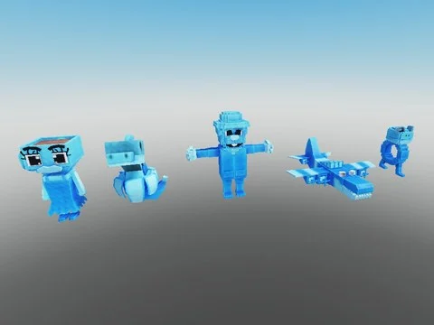
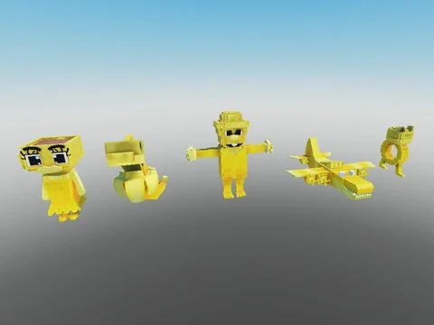
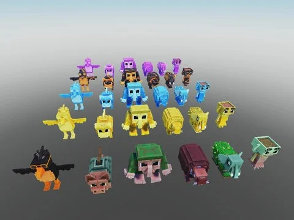
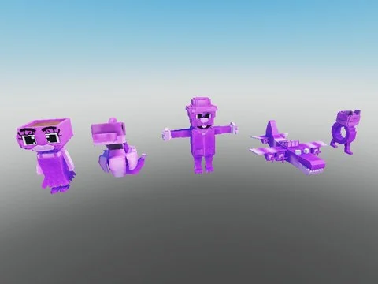
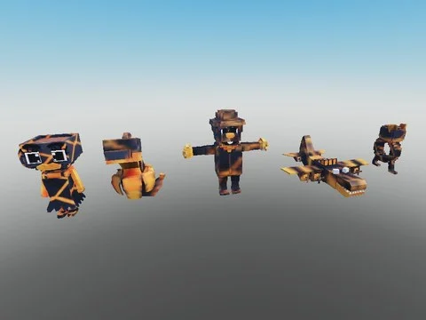

# Steal an Spooky Egg

Sous-catégorie de [Pets & meshes](../Pets%20&%20meshes.md) · **1 élément**

| Aperçu | Élément | Infos |
| --- | --- | --- |
|  | [Carry](Carry%20%C2%B7%20Steal%20an%20Spooky%20Egg%20%28Lm1798%29.md) | Modèle en MeshParts · 2 MeshParts |
|  | [Brainrots Steal an Spooky Egg — Diamond (30)](Brainrots%20Steal%20an%20Spooky%20Egg%20%E2%80%94%20Diamond%20%2830%29.md) | Pack de fichiers · 30 fichiers · 0,3 Mo |
|  | [Brainrots Steal an Spooky Egg — Golden (30)](Brainrots%20Steal%20an%20Spooky%20Egg%20%E2%80%94%20Golden%20%2830%29.md) | Pack de fichiers · 30 fichiers · 0,3 Mo |
|  | [Brainrots Steal an Spooky Egg — Items complet](Brainrots%20Steal%20an%20Spooky%20Egg%20%E2%80%94%20Items%20complet.md) | Pack de fichiers · 1 fichier · 0,1 Mo |
|  | [Brainrots Steal an Spooky Egg — Neon (30)](Brainrots%20Steal%20an%20Spooky%20Egg%20%E2%80%94%20Neon%20%2830%29.md) | Pack de fichiers · 30 fichiers · 0,3 Mo |
|  | [Brainrots Steal an Spooky Egg — Normal (30)](Brainrots%20Steal%20an%20Spooky%20Egg%20%E2%80%94%20Normal%20%2830%29.md) | Pack de fichiers · 30 fichiers · 0,3 Mo |
|  | [Brainrots Steal an Spooky Egg — Ruby (30)](Brainrots%20Steal%20an%20Spooky%20Egg%20%E2%80%94%20Ruby%20%2830%29.md) | Pack de fichiers · 30 fichiers · 0,3 Mo |
