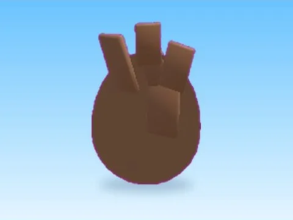

# Chocolate · Rebirth Champions X

Modèle en MeshParts « Chocolate » (Rebirth Champions X). Aperçu rendu dans Roblox Studio avec ses vraies textures.

- **Catégorie** : [Pets & meshes](../Pets%20%26%20meshes.md)
- **Sous-catégorie** : [Œufs & incubateurs](%C5%92ufs%20%26%20incubateurs%20%28Pets%20%26%20meshes%29.md)
- **Type** : Modèle en MeshParts
- **Contenu** : 7 MeshParts
- **Jeu d'origine** : Rebirth Champions X
- **Fichier source** : `models/ByType/Eggs_Incubators/RebirthChampionsX_Chocolate.rbxm` (dans ta bibliothèque `rblx\lib`)
