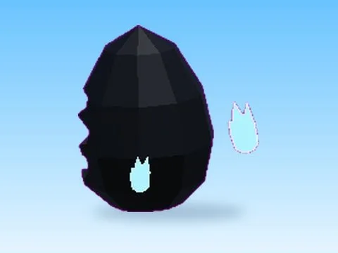

# Egg 2 · Punch Simulator

Modèle en MeshParts « Egg 2 » (Punch Simulator). Aperçu rendu dans Roblox Studio avec ses vraies textures.

- **Catégorie** : [Pets & meshes](../Pets%20&%20meshes.md)
- **Sous-catégorie** : [Œufs & incubateurs](%C5%92ufs%20&%20incubateurs%20%28Pets%20&%20meshes%29.md)
- **Type** : Modèle en MeshParts
- **Contenu** : 4 MeshParts
- **Jeu d'origine** : Punch Simulator
- **Fichier source** : `Assets/models/ByType/Eggs_Incubators/PunchSim_Egg_2.rbxm` (dans le vault)
