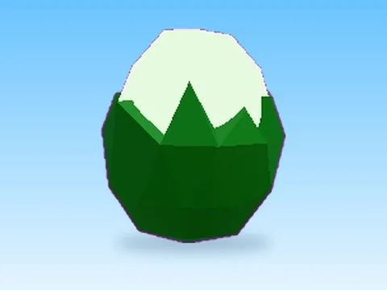

# Egg · Punch Simulator

Modèle en MeshParts « Egg » (Punch Simulator). Aperçu rendu dans Roblox Studio avec ses vraies textures.

- **Catégorie** : [Pets & meshes](../Pets%20%26%20meshes.md)
- **Sous-catégorie** : [Œufs & incubateurs](%C5%92ufs%20%26%20incubateurs%20%28Pets%20%26%20meshes%29.md)
- **Type** : Modèle en MeshParts
- **Contenu** : 2 MeshParts
- **Jeu d'origine** : Punch Simulator
- **Fichier source** : `models/ByType/Eggs_Incubators/PunchSim_Egg.rbxm` (dans ta bibliothèque `rblx\lib`)
