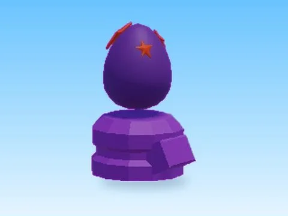

# Surf Board · Pet Pharmica

Modèle en MeshParts « Surf Board » (Pet Pharmica). Aperçu rendu dans Roblox Studio avec ses vraies textures.

- **Catégorie** : [Pets & meshes](../Pets%20&%20meshes.md)
- **Sous-catégorie** : [Œufs & incubateurs](%C5%92ufs%20&%20incubateurs%20%28Pets%20&%20meshes%29.md)
- **Type** : Modèle en MeshParts
- **Contenu** : 5 MeshParts
- **Jeu d'origine** : Pet Pharmica
- **Fichier source** : `Assets/models/ByType/Eggs_Incubators/PetPharmica_SurfBoard.rbxm` (dans le vault)
