# Œufs & incubateurs

Sous-catégorie de [Pets & meshes](../Pets%20%26%20meshes.md) · **56 éléments**

| Aperçu | Élément | Infos |
| --- | --- | --- |
|  | [10M · Rebirth Champions X](10M%20%C2%B7%20Rebirth%20Champions%20X.md) | Modèle en MeshParts · 8 MeshParts |
|  | [5M · Rebirth Champions X](5M%20%C2%B7%20Rebirth%20Champions%20X.md) | Modèle en MeshParts · 5 MeshParts |
| 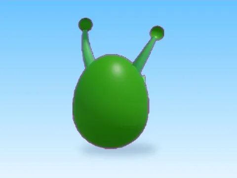 | [Alien · Rebirth Champions X](Alien%20%C2%B7%20Rebirth%20Champions%20X.md) | Modèle en MeshParts · 4 MeshParts |
|  | [Atlantis · Pet Pharmica](Atlantis%20%C2%B7%20Pet%20Pharmica.md) | Modèle en MeshParts · 5 MeshParts |
|  | [Atlantis · Rebirth Champions X](Atlantis%20%C2%B7%20Rebirth%20Champions%20X.md) | Modèle en MeshParts · 4 MeshParts |
|  | [Atlantis 3 · Rebirth Champions X](Atlantis%203%20%C2%B7%20Rebirth%20Champions%20X.md) | Modèle en MeshParts · 13 MeshParts |
|  | [Basic Egg · Mining Masters](Basic%20Egg%20%C2%B7%20Mining%20Masters.md) | Modèle en MeshParts · 8 MeshParts |
| 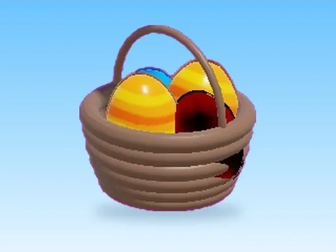 | [Basket · Rebirth Champions X](Basket%20%C2%B7%20Rebirth%20Champions%20X.md) | Modèle en MeshParts · 5 MeshParts |
|  | [Brick Egg · Robot Simulator](Brick%20Egg%20%C2%B7%20Robot%20Simulator.md) | Modèle en MeshParts · 5 MeshParts |
| 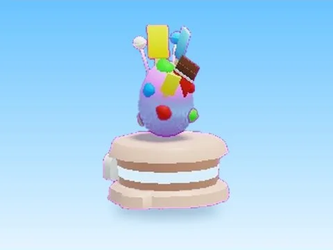 | [Candy Egg · Mining Masters](Candy%20Egg%20%C2%B7%20Mining%20Masters.md) | Modèle en MeshParts · 8 MeshParts |
|  | [Chocolate · Rebirth Champions X](Chocolate%20%C2%B7%20Rebirth%20Champions%20X.md) | Modèle en MeshParts · 7 MeshParts |
| 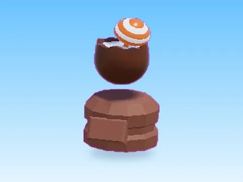 | [Coconut · Pet Pharmica](Coconut%20%C2%B7%20Pet%20Pharmica.md) | Modèle en MeshParts · 5 MeshParts |
| 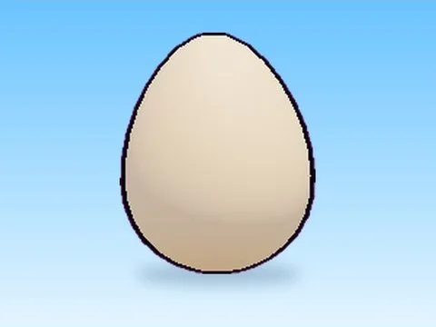 | [Common Egg · Hatching Simulator](Common%20Egg%20%C2%B7%20Hatching%20Simulator.md) | Modèle en MeshParts · 3 MeshParts |
|  | [Common Egg 2 · Hatching Simulator](Common%20Egg%202%20%C2%B7%20Hatching%20Simulator.md) | Modèle en MeshParts · 10 MeshParts |
|  | [Crazy · Rebirth Champions X](Crazy%20%C2%B7%20Rebirth%20Champions%20X.md) | Modèle en MeshParts · 2 MeshParts |
|  | [Crystal Egg · Robot Simulator](Crystal%20Egg%20%C2%B7%20Robot%20Simulator.md) | Modèle en MeshParts · 2 MeshParts |
| 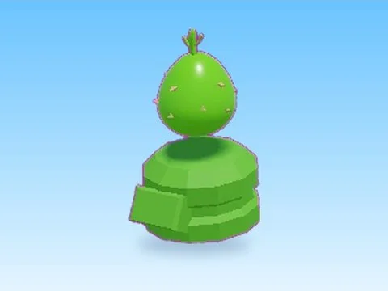 | [Desert · Pet Pharmica](Desert%20%C2%B7%20Pet%20Pharmica.md) | Modèle en MeshParts · 5 MeshParts |
|  | [Desert · Rebirth Champions X](Desert%20%C2%B7%20Rebirth%20Champions%20X.md) | Modèle en MeshParts · 13 MeshParts |
|  | [Dominus · Training Simulator](Dominus%20%C2%B7%20Training%20Simulator.md) | Modèle en MeshParts · 6 MeshParts |
| 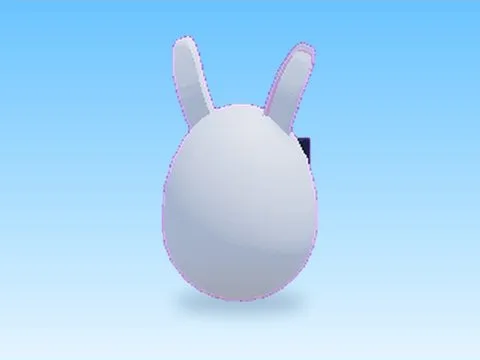 | [Easter · Rebirth Champions X](Easter%20%C2%B7%20Rebirth%20Champions%20X.md) | Modèle en MeshParts · 2 Parts · 3 MeshParts |
| 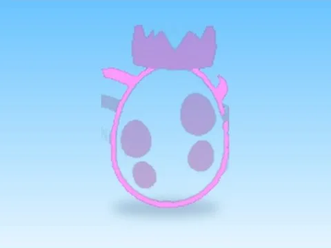 | [Easter Part2 · Rebirth Champions X](Easter%20Part2%20%C2%B7%20Rebirth%20Champions%20X.md) | Modèle en MeshParts · 8 MeshParts |
| 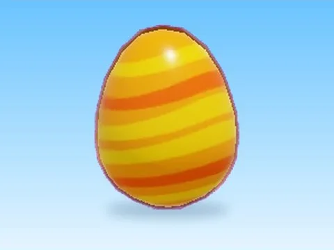 | [Easter Robux · Rebirth Champions X](Easter%20Robux%20%C2%B7%20Rebirth%20Champions%20X.md) | Modèle en MeshParts · 1 MeshPart |
|  | [Egg · Punch Simulator](Egg%20%C2%B7%20Punch%20Simulator.md) | Modèle en MeshParts · 2 MeshParts |
|  | [Egg 2 · Punch Simulator](Egg%202%20%C2%B7%20Punch%20Simulator.md) | Modèle en MeshParts · 4 MeshParts |
|  | [Egg Incubators 200 · Tweeting Simulator](Egg%20Incubators%20200%20%C2%B7%20Tweeting%20Simulator.md) | Modèle en MeshParts · 1 Part · 6 MeshParts |
| 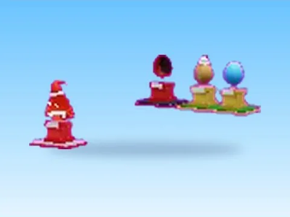 | [Eggs · +1 Jump Every Second](Eggs%20%C2%B7%20%2B1%20Jump%20Every%20Second.md) | Modèle en MeshParts · 18 MeshParts |
| 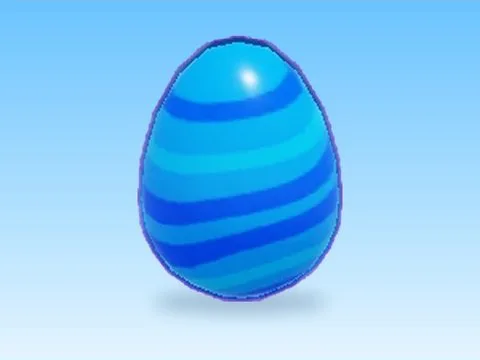 | [Eggs · Rebirth Champions X](Eggs%20%C2%B7%20Rebirth%20Champions%20X.md) | Modèle en MeshParts · 1 MeshPart |
| 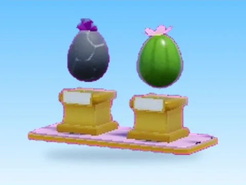 | [Eggs 2 · +1 Jump Every Second](Eggs%202%20%C2%B7%20%2B1%20Jump%20Every%20Second.md) | Modèle en MeshParts · 7 MeshParts |
|  | [Electric Egg · Hatching Simulator](Electric%20Egg%20%C2%B7%20Hatching%20Simulator.md) | Modèle en MeshParts · 4 MeshParts |
| 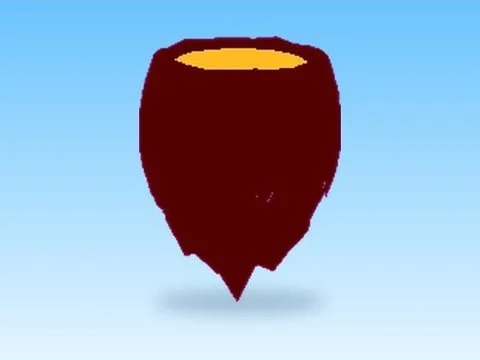 | [Fire · Rebirth Champions X](Fire%20%C2%B7%20Rebirth%20Champions%20X.md) | Modèle en MeshParts · 2 MeshParts |
| 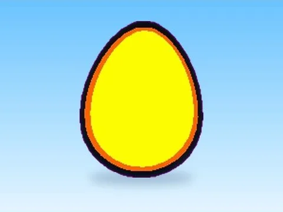 | [Flame Egg · Hatching Simulator](Flame%20Egg%20%C2%B7%20Hatching%20Simulator.md) | Modèle en MeshParts · 4 MeshParts |
| 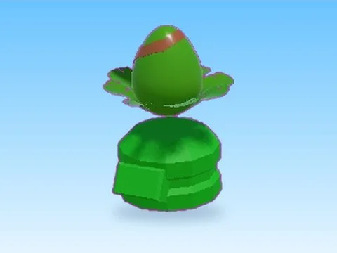 | [Forest · Pet Pharmica](Forest%20%C2%B7%20Pet%20Pharmica.md) | Modèle en MeshParts · 5 MeshParts |
| 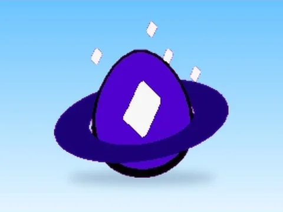 | [Galactic Egg · Hatching Simulator](Galactic%20Egg%20%C2%B7%20Hatching%20Simulator.md) | Modèle en MeshParts · 9 MeshParts |
| 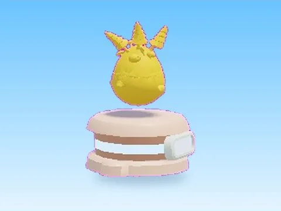 | [Golden Jungle Egg · Mining Masters](Golden%20Jungle%20Egg%20%C2%B7%20Mining%20Masters.md) | Modèle en MeshParts · 8 MeshParts |
|  | [Golden Science Egg · Mining Masters](Golden%20Science%20Egg%20%C2%B7%20Mining%20Masters.md) | Modèle en MeshParts · 8 MeshParts |
| 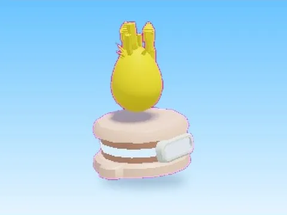 | [Golden Underwater Egg · Mining Masters](Golden%20Underwater%20Egg%20%C2%B7%20Mining%20Masters.md) | Modèle en MeshParts · 8 MeshParts |
| 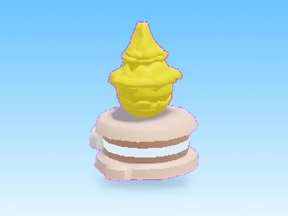 | [Golden Volcano Egg · Mining Masters](Golden%20Volcano%20Egg%20%C2%B7%20Mining%20Masters.md) | Modèle en MeshParts · 8 MeshParts |
|  | [Grass Egg · Robot Simulator](Grass%20Egg%20%C2%B7%20Robot%20Simulator.md) | Modèle en MeshParts · 5 MeshParts |
|  | [Ice · Pet Pharmica](Ice%20%C2%B7%20Pet%20Pharmica.md) | Modèle en MeshParts · 5 MeshParts |
|  | [Icey Egg · Hatching Simulator](Icey%20Egg%20%C2%B7%20Hatching%20Simulator.md) | Modèle en MeshParts · 3 MeshParts |
| 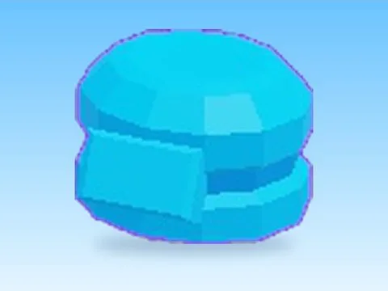 | [Limited · Pet Pharmica](Limited%20%C2%B7%20Pet%20Pharmica.md) | Modèle en MeshParts · 5 MeshParts |
| 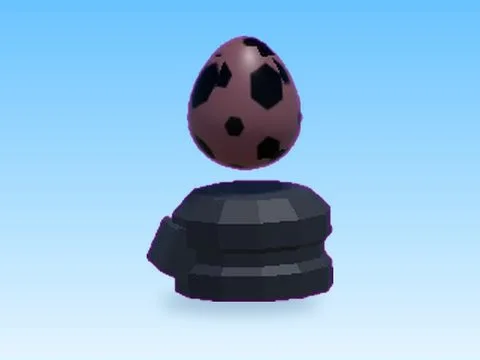 | [Magma · Pet Pharmica](Magma%20%C2%B7%20Pet%20Pharmica.md) | Modèle en MeshParts · 5 MeshParts |
| 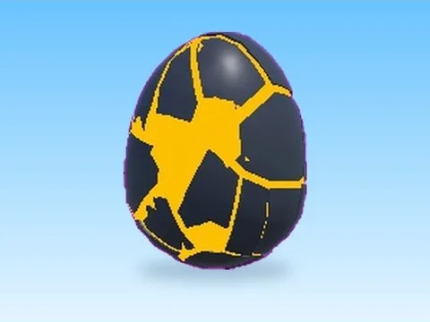 | [Magma · Rebirth Champions X](Magma%20%C2%B7%20Rebirth%20Champions%20X.md) | Modèle en MeshParts · 2 MeshParts |
| 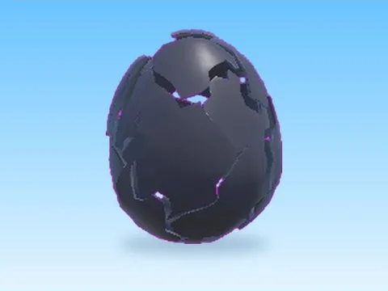 | [Magma Egg · Robot Simulator](Magma%20Egg%20%C2%B7%20Robot%20Simulator.md) | Modèle en MeshParts · 2 MeshParts |
| 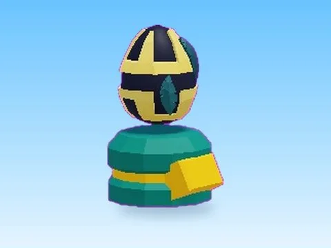 | [Pirate · Pet Pharmica](Pirate%20%C2%B7%20Pet%20Pharmica.md) | Modèle en MeshParts · 5 MeshParts |
|  | [Regular Crate Open · Bakery Simulator](Regular%20Crate%20Open%20%C2%B7%20Bakery%20Simulator.md) | Modèle en MeshParts · 2 Parts · 21 MeshParts |
|  | [Release Egg · Hatching Simulator](Release%20Egg%20%C2%B7%20Hatching%20Simulator.md) | Modèle en MeshParts · 12 MeshParts |
| 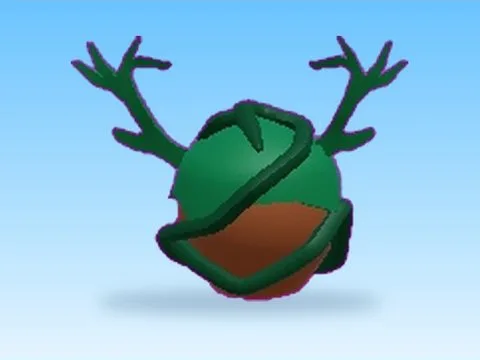 | [Spawn1 · Training Simulator](Spawn1%20%C2%B7%20Training%20Simulator.md) | Modèle en MeshParts · 4 MeshParts |
| 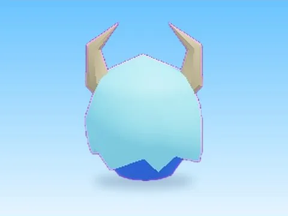 | [Spawn2 · Training Simulator](Spawn2%20%C2%B7%20Training%20Simulator.md) | Modèle en MeshParts · 3 MeshParts |
| 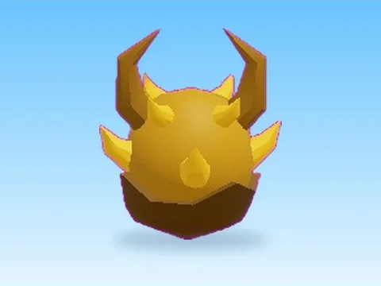 | [Spawn3 · Training Simulator](Spawn3%20%C2%B7%20Training%20Simulator.md) | Modèle en MeshParts · 5 MeshParts |
|  | [Spawn4 · Training Simulator](Spawn4%20%C2%B7%20Training%20Simulator.md) | Modèle en MeshParts · 4 MeshParts |
|  | [Spike Egg · Robot Simulator](Spike%20Egg%20%C2%B7%20Robot%20Simulator.md) | Modèle en MeshParts · 1 MeshPart |
| 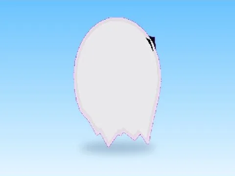 | [Spooky · Rebirth Champions X](Spooky%20%C2%B7%20Rebirth%20Champions%20X.md) | Modèle en MeshParts · 2 Parts · 2 MeshParts |
|  | [Surf Board · Pet Pharmica](Surf%20Board%20%C2%B7%20Pet%20Pharmica.md) | Modèle en MeshParts · 5 MeshParts |
| 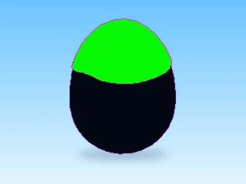 | [Toxic Toxic · Rebirth Champions X](Toxic%20Toxic%20%C2%B7%20Rebirth%20Champions%20X.md) | Modèle en MeshParts · 4 MeshParts |
|  | [Void Egg · Hatching Simulator](Void%20Egg%20%C2%B7%20Hatching%20Simulator.md) | Modèle en MeshParts · 11 MeshParts |
