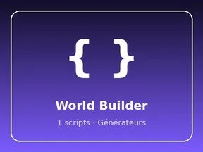

# World Builder

Générateur : 1 scripts.

- **Catégorie** : [Systèmes & kits](../Syst%C3%A8mes%20%26%20kits.md)
- **Sous-catégorie** : [Générateurs](G%C3%A9n%C3%A9rateurs.md)
- **Type** : Système de jeu
- **Contenu** : 1 script · 1 instance
- **Fichier source** : `systems/Generators/WorldBuilder.rbxm` (dans ta bibliothèque `rblx\lib`)
