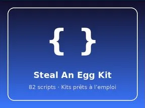

# Steal An Egg Kit

Kits prêts à l’emploi : 82 scripts.

- **Catégorie** : [Systèmes & kits](../Syst%C3%A8mes%20%26%20kits.md)
- **Sous-catégorie** : [Kits prêts à l’emploi](Kits%20pr%C3%AAts%20%C3%A0%20l%E2%80%99emploi.md)
- **Type** : Système de jeu
- **Contenu** : 82 scripts · 4 005 instances
- **Fichier source** : `kits/StealAnEggKit/StealAnEggKit.rbxm` (dans ta bibliothèque `rblx\lib`)
