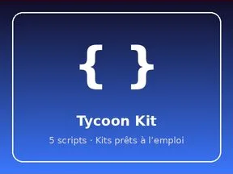

# Tycoon Kit

Kits prêts à l’emploi : 5 scripts.

- **Catégorie** : [Systèmes & kits](../Syst%C3%A8mes%20&%20kits.md)
- **Sous-catégorie** : [Kits prêts à l’emploi](Kits%20pr%C3%AAts%20%C3%A0%20l%E2%80%99emploi.md)
- **Type** : Système de jeu
- **Contenu** : 5 scripts · 581 instances
- **Fichier source** : `kits/TycoonKit/TycoonKit.rbxm` (dans ta bibliothèque `rblx\lib`)
