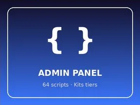

# ADMIN PANEL

Kits tier : 64 scripts.

- **Catégorie** : [Systèmes & kits](../Syst%C3%A8mes%20&%20kits.md)
- **Sous-catégorie** : [Kits tiers](Kits%20tiers.md)
- **Type** : Système de jeu
- **Contenu** : 64 scripts · 76 instances
- **Fichier source** : `kits/ThirdParty/ADMIN PANEL.rbxm` (dans ta bibliothèque `rblx\lib`)
