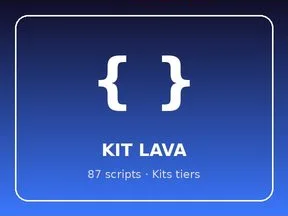

# KIT LAVA

Kits tier : 87 scripts.

- **Catégorie** : [Systèmes & kits](../Syst%C3%A8mes%20%26%20kits.md)
- **Sous-catégorie** : [Kits tiers](Kits%20tiers.md)
- **Type** : Système de jeu
- **Contenu** : 87 scripts · 6 479 instances
- **Fichier source** : `kits/ThirdParty/KIT LAVA.rbxm` (dans ta bibliothèque `rblx\lib`)
