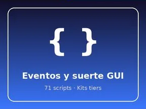

# Kits tiers

Sous-catégorie de [Systèmes & kits](../Syst%C3%A8mes%20&%20kits.md) · **3 éléments**

| Aperçu | Élément | Infos |
| --- | --- | --- |
|  | [ADMIN PANEL](ADMIN%20PANEL.md) | Système de jeu · 64 scripts · 76 instances |
|  | [Eventos y suerte GUI](Eventos%20y%20suerte%20GUI.md) | Système de jeu · 71 scripts · 4 828 instances |
|  | [KIT LAVA](KIT%20LAVA.md) | Système de jeu · 87 scripts · 6 479 instances |
