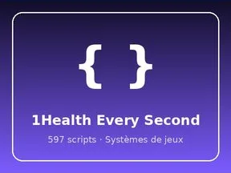
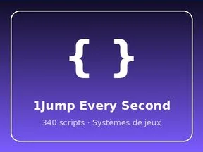
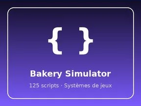
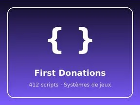
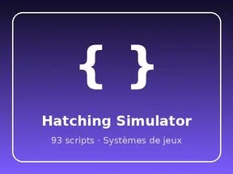
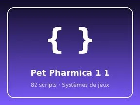
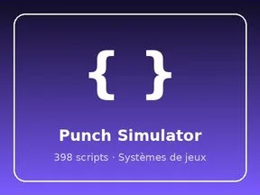
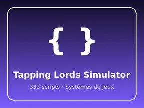
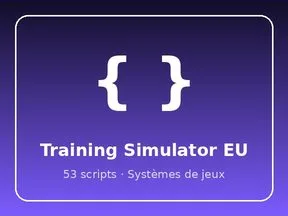
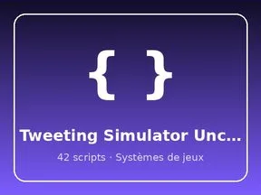

# Systèmes de jeux

Sous-catégorie de [Systèmes & kits](../Syst%C3%A8mes%20%26%20kits.md) · **18 éléments**

| Aperçu | Élément | Infos |
| --- | --- | --- |
|  | [1Health Every Second](1Health%20Every%20Second.md) | Système de jeu · 597 scripts · 1 297 instances |
|  | [1Jump Every Second](1Jump%20Every%20Second%20%C2%B7%20Syst%C3%A8mes%20de%20jeux.md) | Système de jeu · 340 scripts · 1 908 instances |
|  | [Bakery Simulator](Bakery%20Simulator%20%C2%B7%20Syst%C3%A8mes%20de%20jeux.md) | Système de jeu · 125 scripts · 2 400 instances |
|  | [Billionaire Tycoon](Billionaire%20Tycoon%20%C2%B7%20Syst%C3%A8mes%20de%20jeux.md) | Système de jeu · 90 scripts · 1 338 instances |
|  | [Cashgrab Bridge EU](Cashgrab%20Bridge%20EU%20%C2%B7%20Syst%C3%A8mes%20de%20jeux.md) | Système de jeu · 134 scripts · 1 173 instances |
|  | [First Donations](First%20Donations%20%C2%B7%20Syst%C3%A8mes%20de%20jeux.md) | Système de jeu · 412 scripts · 1 366 instances |
|  | [Glass Bridge](Glass%20Bridge%20%C2%B7%20Syst%C3%A8mes%20de%20jeux.md) | Système de jeu · 96 scripts · 646 instances |
|  | [Hatching Simulator](Hatching%20Simulator%20%C2%B7%20Syst%C3%A8mes%20de%20jeux.md) | Système de jeu · 93 scripts · 896 instances |
|  | [Mining Masters](Mining%20Masters%20%C2%B7%20Syst%C3%A8mes%20de%20jeux.md) | Système de jeu · 141 scripts · 1 746 instances |
|  | [Pet Pharmica 1 1](Pet%20Pharmica%201%201%20%C2%B7%20Syst%C3%A8mes%20de%20jeux.md) | Système de jeu · 82 scripts · 6 937 instances |
|  | [Punch Simulator](Punch%20Simulator%20%C2%B7%20Syst%C3%A8mes%20de%20jeux.md) | Système de jeu · 398 scripts · 626 instances |
|  | [Rebirth Champions X](Rebirth%20Champions%20X%20%C2%B7%20Syst%C3%A8mes%20de%20jeux.md) | Système de jeu · 86 scripts · 418 instances |
|  | [Robot Simulator](Robot%20Simulator%20%C2%B7%20Syst%C3%A8mes%20de%20jeux.md) | Système de jeu · 89 scripts · 237 instances |
|  | [Shoot ABrainrot EU](Shoot%20ABrainrot%20EU%20%C2%B7%20Syst%C3%A8mes%20de%20jeux.md) | Système de jeu · 85 scripts · 803 instances |
|  | [Tapping Lords Simulator](Tapping%20Lords%20Simulator%20%C2%B7%20Syst%C3%A8mes%20de%20jeux.md) | Système de jeu · 333 scripts · 5 624 instances |
|  | [Training Simulator EU](Training%20Simulator%20EU%20%C2%B7%20Syst%C3%A8mes%20de%20jeux.md) | Système de jeu · 53 scripts · 212 instances |
|  | [Tweeting Simulator Uncopy Locked](Tweeting%20Simulator%20Uncopy%20Locked%20%C2%B7%20Syst%C3%A8mes%20de%20jeux.md) | Système de jeu · 42 scripts · 87 instances |
|  | [UNCOPYLOCKED Magnet Simulator 2](UNCOPYLOCKED%20Magnet%20Simulator%202%20%C2%B7%20Syst%C3%A8mes%20de%20jeux.md) | Système de jeu · 22 scripts · 64 instances |
