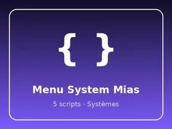

# Menu System Mias

Système : 5 scripts.

- **Catégorie** : [Systèmes & kits](../Syst%C3%A8mes%20&%20kits.md)
- **Sous-catégorie** : [Systèmes](Syst%C3%A8mes.md)
- **Type** : Système de jeu
- **Contenu** : 5 scripts · 9 086 instances
- **Fichier source** : `systems/MenuSystem_Mias.rbxm` (dans ta bibliothèque `rblx\lib`)
