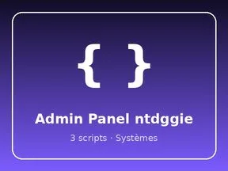
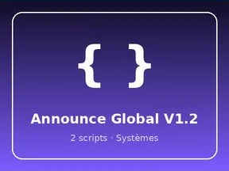
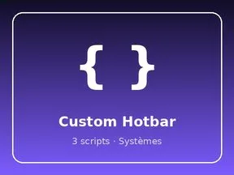
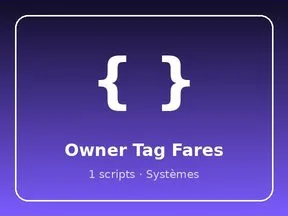
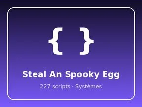

# Systèmes

Sous-catégorie de [Systèmes & kits](../Syst%C3%A8mes%20&%20kits.md) · **8 éléments**

| Aperçu | Élément | Infos |
| --- | --- | --- |
|  | [Admin Panel ntdggie](Admin%20Panel%20ntdggie.md) | Système de jeu · 3 scripts · 590 instances |
|  | [Announce Global V1.2](Announce%20Global%20V1.2.md) | Système de jeu · 2 scripts · 7 instances |
|  | [Custom Hotbar](Custom%20Hotbar.md) | Système de jeu · 3 scripts · 99 instances |
|  | [Feedback System Lunor](Feedback%20System%20Lunor.md) | Système de jeu · 2 scripts · 3 instances |
|  | [Menu System Mias](Menu%20System%20Mias.md) | Système de jeu · 5 scripts · 9 086 instances |
|  | [Owner Tag Fares](Owner%20Tag%20Fares.md) | Système de jeu · 1 script · 2 instances |
|  | [Spin Wheel Emo Studio](Spin%20Wheel%20Emo%20Studio.md) | Système de jeu · 8 scripts · 136 instances |
|  | [Steal An Spooky Egg](Steal%20An%20Spooky%20Egg.md) | Système de jeu · 227 scripts · 287 instances |
