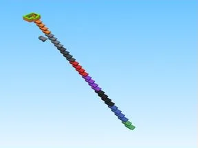
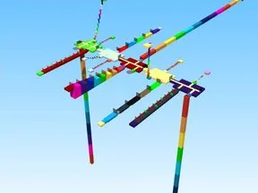

# +1 Every Second

Sous-catégorie de [Templates de jeux](../Templates%20de%20jeux.md) · **5 éléments**

| Aperçu | Élément | Infos |
| --- | --- | --- |
|  | [+1 Drill And Mine](%2B1%20Drill%20And%20Mine.md) | Place complète (.rbxl) · 204 scripts · 250 434 instances |
|  | [+1 Keyboard Snow Escape](%2B1%20Keyboard%20Snow%20Escape.md) | Place complète (.rbxl) · 1 666 scripts · 331 158 instances |
|  | [+1 Speed Keyboard Escape Candy](%2B1%20Speed%20Keyboard%20Escape%20Candy.md) | Place complète (.rbxl) · 1 552 scripts · 175 745 instances |
|  | [+1Health Every Second](%2B1Health%20Every%20Second.md) | Place complète (.rbxl) · 703 scripts · 9 593 instances |
|  | [1Jump Every Second](1Jump%20Every%20Second%20%C2%B7%20%2B1%20Every%20Second.md) | Place complète (.rbxl) · 438 scripts · 7 217 instances |
