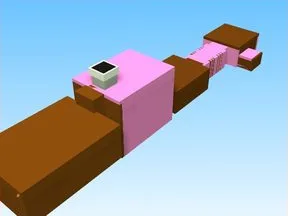

# +1 Speed Keyboard Escape Candy

Place Roblox complète (.rbxl) : 1552 scripts, 175745 instances.

- **Catégorie** : [Templates de jeux](../Templates%20de%20jeux.md)
- **Sous-catégorie** : [+1 Every Second](+1%20Every%20Second.md)
- **Type** : Place complète (.rbxl)
- **Contenu** : 1 552 scripts · 175 745 instances
- **Fichier source** : `games/EverySecond/+1_Speed_Keyboard_Escape_Candy.rbxl` (dans ta bibliothèque `rblx\lib`)
