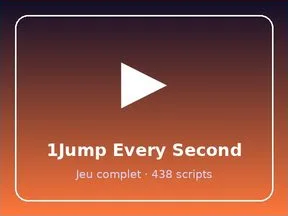

# 1Jump Every Second

Place Roblox complète (.rbxl) : 438 scripts, 7217 instances.

- **Catégorie** : [Templates de jeux](../Templates%20de%20jeux.md)
- **Sous-catégorie** : [+1 Every Second](%2B1%20Every%20Second.md)
- **Type** : Place complète (.rbxl)
- **Contenu** : 438 scripts · 7 217 instances
- **Fichier source** : `games/EverySecond/1JumpEverySecond.rbxl` (dans ta bibliothèque `rblx\lib`)
