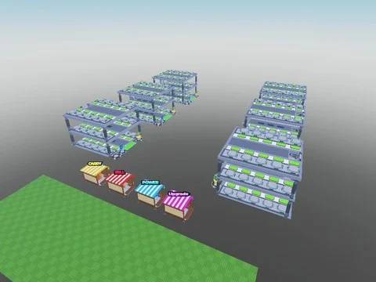
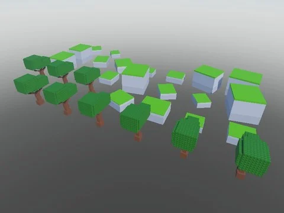

# Brainrot

Sous-catégorie de [Templates de jeux](../Templates%20de%20jeux.md) · **5 éléments**

| Aperçu | Élément | Infos |
| --- | --- | --- |
|  | [Candy Rot bestfileevere](Candy%20Rot%20bestfileevere.md) | Place complète (.rbxl) · 1 947 scripts · 405 255 instances |
|  | [Save Brainrots From Backrooms](Save%20Brainrots%20From%20Backrooms.md) | Place complète (.rbxl) · 313 scripts · 21 218 instances |
|  | [Shoot ABrainrot EU](Shoot%20ABrainrot%20EU%20%C2%B7%20Brainrot.md) | Place complète (.rbxl) · 98 scripts · 8 691 instances |
|  | [Drill For LuckyBlocks](Drill%20For%20LuckyBlocks.md) | Place complète (.rbxl) · 540 scripts · 245 611 instances · 3,2 Mo |
|  | [Roll A Brainrot (ZEVR)](Roll%20A%20Brainrot%20%28ZEVR%29.md) | Place complète (.rbxl) · 220 scripts · 14 417 instances · 0,8 Mo |
