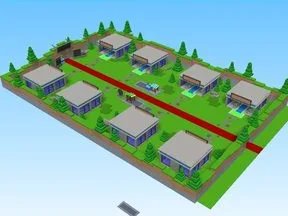
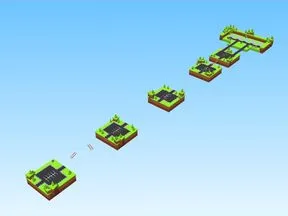

# Divers

Sous-catégorie de [Templates de jeux](../Templates%20de%20jeux.md) · **3 éléments**

| Aperçu | Élément | Infos |
| --- | --- | --- |
|  | [Lab Noctis](Lab%20Noctis.md) | Place complète (.rbxl) · 333 scripts · 94 268 instances |
|  | [Zenith Roblox Modded](Zenith%20Roblox%20Modded.md) | Place complète (.rbxl) · 101 scripts · 18 559 instances |
|  | [MiniGame (combat à l’épée par manches)](MiniGame%20%28combat%20%C3%A0%20l%E2%80%99%C3%A9p%C3%A9e%20par%20manches%29.md) | Place complète (.rbxl) · 106 scripts · 5 340 instances · 0,6 Mo |
