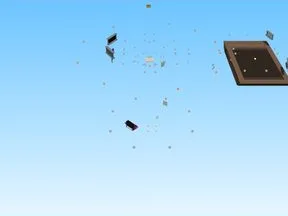

# First Donations

Place Roblox complète (.rbxl) : 849 scripts, 17991 instances.

- **Catégorie** : [Templates de jeux](../Templates%20de%20jeux.md)
- **Sous-catégorie** : [Donation](Donation.md)
- **Type** : Place complète (.rbxl)
- **Contenu** : 849 scripts · 17 991 instances
- **Fichier source** : `games/Donation/First_Donations.rbxl` (dans ta bibliothèque `rblx\lib`)
