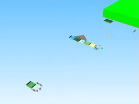

# Pet Pharmica 1 1

Place Roblox complète (.rbxl) : 1048 scripts, 29598 instances.

- **Catégorie** : [Templates de jeux](../Templates%20de%20jeux.md)
- **Sous-catégorie** : [Simulators](Simulators.md)
- **Type** : Place complète (.rbxl)
- **Contenu** : 1 048 scripts · 29 598 instances
- **Fichier source** : `Assets/games/Simulators/Pet_Pharmica_1_1.rbxl` (dans le vault)
