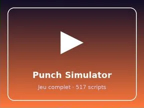

# Punch Simulator

Place Roblox complète (.rbxl) : 517 scripts, 15853 instances.

- **Catégorie** : [Templates de jeux](../Templates%20de%20jeux.md)
- **Sous-catégorie** : [Simulators](Simulators.md)
- **Type** : Place complète (.rbxl)
- **Contenu** : 517 scripts · 15 853 instances
- **Fichier source** : `Assets/games/Simulators/Punch Simulator.rbxl` (dans le vault)
