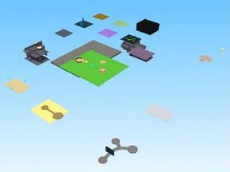

# Rebirth Champions X

Place Roblox complète (.rbxl) : 100 scripts, 50317 instances.

- **Catégorie** : [Templates de jeux](../Templates%20de%20jeux.md)
- **Sous-catégorie** : [Simulators](Simulators.md)
- **Type** : Place complète (.rbxl)
- **Contenu** : 100 scripts · 50 317 instances
- **Fichier source** : `games/Simulators/Rebirth Champions X.rbxl` (dans ta bibliothèque `rblx\lib`)
