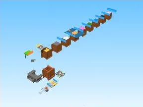
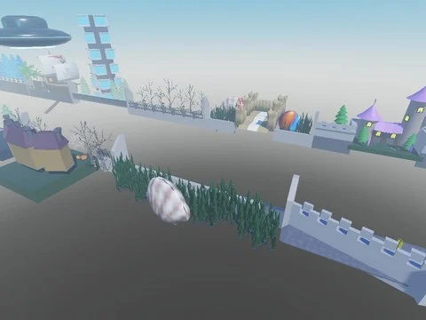

# Simulators

Sous-catégorie de [Templates de jeux](../Templates%20de%20jeux.md) · **13 éléments**

| Aperçu | Élément | Infos |
| --- | --- | --- |
|  | [Bakery Simulator](Bakery%20Simulator%20%C2%B7%20Simulators.md) | Place complète (.rbxl) · 208 scripts · 30 724 instances |
|  | [Hatching Simulator](Hatching%20Simulator%20%C2%B7%20Simulators.md) | Place complète (.rbxl) · 220 scripts · 7 060 instances |
|  | [Mining Masters](Mining%20Masters%20%C2%B7%20Simulators.md) | Place complète (.rbxl) · 186 scripts · 21 840 instances |
|  | [Pet Pharmica 1 1](Pet%20Pharmica%201%201%20%C2%B7%20Simulators.md) | Place complète (.rbxl) · 1 048 scripts · 29 598 instances |
|  | [Punch Simulator](Punch%20Simulator%20%C2%B7%20Simulators.md) | Place complète (.rbxl) · 517 scripts · 15 853 instances |
|  | [Rebirth Champions X](Rebirth%20Champions%20X%20%C2%B7%20Simulators.md) | Place complète (.rbxl) · 100 scripts · 50 317 instances |
|  | [Robot Simulator](Robot%20Simulator%20%C2%B7%20Simulators.md) | Place complète (.rbxl) · 330 scripts · 42 326 instances |
|  | [Tapping Lords Simulator](Tapping%20Lords%20Simulator%20%C2%B7%20Simulators.md) | Place complète (.rbxl) · 1 101 scripts · 12 773 instances |
|  | [Training Simulator EU](Training%20Simulator%20EU%20%C2%B7%20Simulators.md) | Place complète (.rbxl) · 126 scripts · 7 415 instances |
|  | [Tweeting Simulator Uncopy Locked](Tweeting%20Simulator%20Uncopy%20Locked%20%C2%B7%20Simulators.md) | Place complète (.rbxl) · 185 scripts · 7 743 instances |
|  | [UNCOPYLOCKED Magnet Simulator 2](UNCOPYLOCKED%20Magnet%20Simulator%202%20%C2%B7%20Simulators.md) | Place complète (.rbxl) · 80 scripts · 7 564 instances |
|  | [Mine a Planet BETA 9 (place 121125129560252)](Mine%20a%20Planet%20BETA%209%20%28place%20121125129560252%29.md) | Place complète (.rbxl) · 675 scripts · 44 498 instances · 39,3 Mo |
|  | [Unboxing Simulator](Unboxing%20Simulator.md) | Place complète (.rbxl) · 138 scripts · 15 442 instances · 0,7 Mo |
