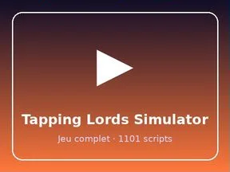

# Tapping Lords Simulator

Place Roblox complète (.rbxl) : 1101 scripts, 12773 instances.

- **Catégorie** : [Templates de jeux](../Templates%20de%20jeux.md)
- **Sous-catégorie** : [Simulators](Simulators.md)
- **Type** : Place complète (.rbxl)
- **Contenu** : 1 101 scripts · 12 773 instances
- **Fichier source** : `games/Simulators/Tapping-Lords-Simulator.rbxl` (dans ta bibliothèque `rblx\lib`)
