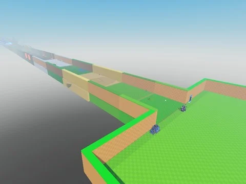

# Steal An Egg (place 107778070777162)

Dump client (SaveInstance) de la place Steal An Egg 107778070777162 : map, plots, stands, 66 ScreenGui et ReplicatedStorage complet, mais aucun script serveur (pas de ServerScriptService). Scripts locaux décompilés.

- **Catégorie** : [Templates de jeux](../Templates%20de%20jeux.md)
- **Sous-catégorie** : [Steal a…](Steal%20a%E2%80%A6.md)
- **Type** : Place complète (.rbxl)
- **Contenu** : 1 694 scripts · 139 511 instances · 2,6 Mo
- **Jeu d'origine** : Steal An Egg
- **Fichier source** : `Assets/games/Steal/Steal An Egg 107778070777162.rbxl` (dans le vault)
