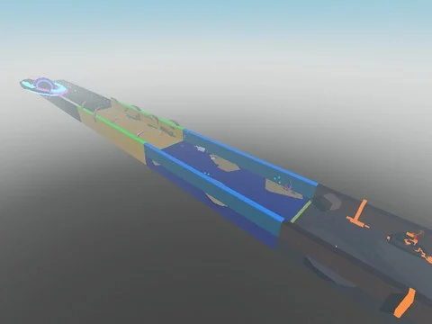

# Steal An Egg Sourced

Version « sourcée » de Steal An Egg avec scripts serveur (Bootstrap, Controllers, TrollActionServer, DatabaseNetworkBridge…), 77 ScreenGui et un dossier Workspace/Aclaude d’ajouts. Contient des restes d’outils Studio (MCP, HarmlessAssetManagerConnector).

- **Catégorie** : [Templates de jeux](../Templates%20de%20jeux.md)
- **Sous-catégorie** : [Steal a…](Steal%20a%E2%80%A6.md)
- **Type** : Place complète (.rbxl)
- **Contenu** : 2 422 scripts · 63 235 instances · 13,2 Mo
- **Jeu d'origine** : Steal An Egg
- **Fichier source** : `Assets/games/Steal/Steal An Egg Sourced.rbxl` (dans le vault)

> ⚠️ **Sécurité** : TrollFreeAdmin (ServerScriptService et Workspace/Aclaude) donne des actions troll gratuites au joueur codé en dur « Axelsteele10 » : à retirer. Restes d’outils Studio : __MCP_CommandListener (x2) et Workspace/HarmlessAssetManagerConnector (requêtes vers localhost).
