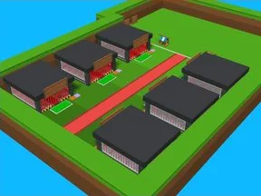

# Steal From Template Spider

Place Roblox complète (.rbxl) : 116 scripts, 19991 instances.

- **Catégorie** : [Templates de jeux](../Templates%20de%20jeux.md)
- **Sous-catégorie** : [Steal a…](Steal%20a%E2%80%A6.md)
- **Type** : Place complète (.rbxl)
- **Contenu** : 116 scripts · 19 991 instances
- **Fichier source** : `Assets/games/Steal/Steal_From_Template_Spider.rbxl` (dans le vault)
