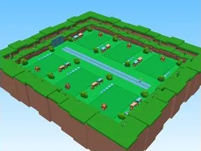

# PU Royale Template

Place Roblox complète (.rbxl) : 659 scripts, 71131 instances.

- **Catégorie** : [Templates de jeux](../Templates%20de%20jeux.md)
- **Sous-catégorie** : [Templates](Templates.md)
- **Type** : Place complète (.rbxl)
- **Contenu** : 659 scripts · 71 131 instances
- **Fichier source** : `Assets/kits/Templates/PU - Royale Template.rbxl` (dans le vault)
