# Templates

Sous-catégorie de [Templates de jeux](../Templates%20de%20jeux.md) · **24 éléments**

| Aperçu | Élément | Infos |
| --- | --- | --- |
|  | [+1 Speed V1 Kit](%2B1%20Speed%20V1%20Kit.md) | Place complète (.rbxl) · 88 scripts · 67 992 instances |
| 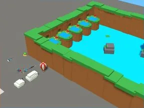 | [Build A Plane Template](Build%20A%20Plane%20Template.md) | Place complète (.rbxl) · 74 scripts · 46 579 instances |
| 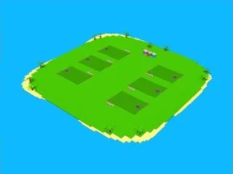 | [Build Your Base Template](Build%20Your%20Base%20Template.md) | Place complète (.rbxl) · 292 scripts · 6 383 instances |
|  | [Climb For Brainrots \[ No Tested! \]](Climb%20For%20Brainrots%20No%20Tested%21.md) | Place complète (.rbxl) · 104 scripts · 42 017 instances |
| 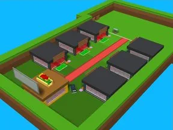 | [Don't Steal From Brainrots \[ CMDR \] (nettoye)](Don%27t%20Steal%20From%20Brainrots%20CMDR%20%28nettoye%29.md) | Place complète (.rbxl) · 212 scripts · 31 036 instances |
|  | [Find The Button Template](Find%20The%20Button%20Template.md) | Place complète (.rbxl) · 320 scripts · 40 281 instances |
|  | [Find The Template](Find%20The%20Template.md) | Place complète (.rbxl) · 394 scripts · 65 802 instances |
| 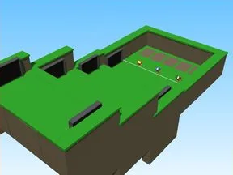 | [Jump For Cars](Jump%20For%20Cars.md) | Place complète (.rbxl) · 118 scripts · 7 701 instances |
| 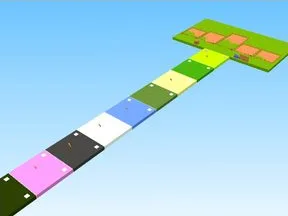 | [Lift An Egg Template](Lift%20An%20Egg%20Template.md) | Place complète (.rbxl) · 252 scripts · 802 632 instances |
| 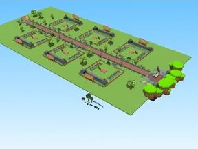 | [Mine A Template](Mine%20A%20Template.md) | Place complète (.rbxl) · 157 scripts · 41 968 instances |
| 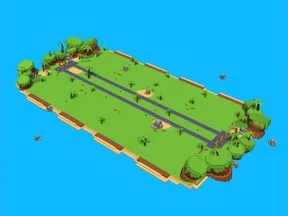 | [My Fishing Template](My%20Fishing%20Template.md) | Place complète (.rbxl) · 97 scripts · 7 763 instances |
| 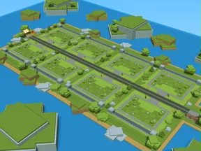 | [My Garden Template](My%20Garden%20Template.md) | Place complète (.rbxl) · 66 scripts · 9 926 instances |
|  | [My Garden Template \[ Better \]](My%20Garden%20Template%20Better.md) | Place complète (.rbxl) · 66 scripts · 9 928 instances |
|  | [My Lucky Block Template](My%20Lucky%20Block%20Template.md) | Place complète (.rbxl) · 94 scripts · 3 787 instances |
| 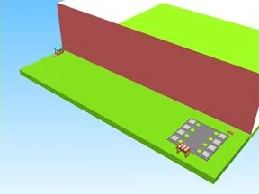 | [PU Dont Wake Up Template](PU%20Dont%20Wake%20Up%20Template.md) | Place complète (.rbxl) · 136 scripts · 15 523 instances |
| 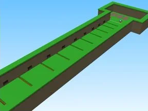 | [PU Escape Tsunami For Template](PU%20Escape%20Tsunami%20For%20Template.md) | Place complète (.rbxl) · 86 scripts · 7 078 instances |
| 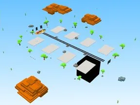 | [PU Mutate Or Lose Template](PU%20Mutate%20Or%20Lose%20Template.md) | Place complète (.rbxl) · 80 scripts · 11 380 instances |
| 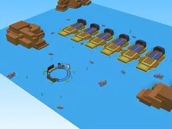 | [PU Plants Vs Template](PU%20Plants%20Vs%20Template.md) | Place complète (.rbxl) · 543 scripts · 29 999 instances |
|  | [PU Royale Template](PU%20Royale%20Template.md) | Place complète (.rbxl) · 659 scripts · 71 131 instances |
|  | [PU Steal a Template](PU%20Steal%20a%20Template.md) | Place complète (.rbxl) · 157 scripts · 38 862 instances |
| 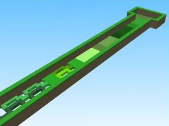 | [Run For Cars](Run%20For%20Cars.md) | Place complète (.rbxl) · 443 scripts · 9 338 instances |
| 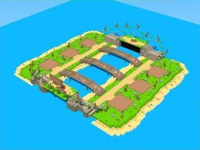 | [Shoot A Brainrot Template](Shoot%20A%20Brainrot%20Template.md) | Place complète (.rbxl) · 98 scripts · 8 689 instances |
| 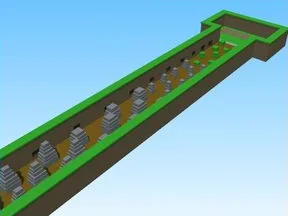 | [Survive Lava For Cars](Survive%20Lava%20For%20Cars.md) | Place complète (.rbxl) · 113 scripts · 8 168 instances |
|  | [Tutorial Template](Tutorial%20Template.md) | Place complète (.rbxl) · 5 scripts · 387 instances |
